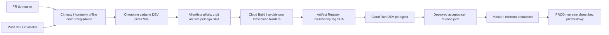
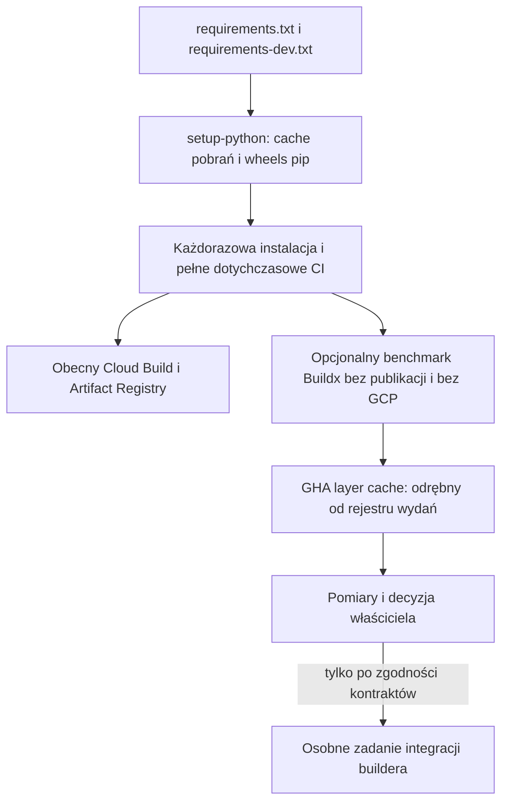

# TRIPSE — plan Artifact Registry i optymalizacji CI/CD

**Status: plan usprawnień; CI-001 zaimplementowane lokalnie, odbiór hosted otwarty.** Repozytorium:
`piotrbarabasz/tripse-ai-demo`, lokalna gałąź `dev`, bazowy HEAD
`ae8c051513f0300d19a16d7ce7b96499b6f388cd`, 2026-10-28.
Aktualizacja 2026-10-29: CI-001 ma lokalną implementację cache pip i podsumowania
pomiarów, zweryfikowaną testami. Nie wysłano workflow ani nie potwierdzono poprawy
wydajności na GitHub Actions. CI-002–CI-005 pozostają propozycjami.
[Raport, baseline i procedura cold/warm](CI_001_PYTHON_CACHE.md).

Powiązania: [obecny CI/CD](GITHUB_CICD.md), [dowody wydania](RELEASE_2026_10_28.md),
[deployment](DEPLOY_GCP.md), [ADR-0012](adr/0012-github-actions-delivery.md),
[nowa propozycja ADR-0015](adr/0015-registry-build-cache-evolution.md).

## 1. Najważniejsze ustalenie

**Artifact Registry jest już częścią TRIPSE.** Nie należy tworzyć drugiego rejestru
ani nowego pipeline'u, zakładając brak istniejącej implementacji.
Zakres CI-001–CI-005 oznacza tutaj przegląd i rozwój obecnych mechanizmów.

Kod i dokumentacja potwierdzają następujący proces:

Ścieżka PR kończy się na CI: nie uzyskuje WIF ani dostępu do chmury.
Publikacja i wdrożenia pozostają rozdzielone od testów oraz od wykonywania zadań
planera. GCS/Firestore/Tasks w `cloud_demo` są istniejącą implementacją, a nie
nowym projektem migracji proponowanym przez ten plan.

## 2. Audyt: stan obecny i przyszłe zmiany

| Obszar | Fakt z repozytorium | Co pozostaje do oceny |
|---|---|---|
| Python CI | `ci.yml`: Ubuntu 24.04, Python 3.12, `make install-dev`, `make test`, offline contracts, Chromium i `make test-browser` | CI-001: cache pip dodany lokalnie; baseline odczytany; hosted cold/warm oczekuje walidacji |
| Zależności | `requirements-dev.txt` dołącza `requirements.txt`; wersje bezpośrednie przypięte | Pełna reprodukowalność zależności przechodnich i aktualizacji |
| Kontener | `Dockerfile`: Python 3.12-slim, Uvicorn `app.main:app`, 0.0.0.0:8000, warstwa zależności przed kodem | Pin digestu obrazu bazowego, non-root i pomiary rozmiaru/startu; bez zmiany istniejącego kontraktu portu |
| Źródło obrazu | `deployment.py:source_files()` eksportuje wyłącznie dozwolone pliki konkretnego commita i weryfikuje ścieżki; build dodaje `_build_version.txt` | Każdy nowy builder musi zachować tę samą granicę źródła |
| Builder | `deployment.py:build()` korzysta z regionalnego Cloud Build, jawnego stagingu/logów i konta buildera | Buildx nie jest obecnym builderem wydania; jego przyjęcie wymaga dowodu równoważnej proweniencji |
| Artifact Registry | Istniejący kontrakt wymaga formatu Docker i niezmiennych tagów; tag pełnego SHA jest ponownie używany bez przebudowy | Retencja, wzrost zajętości, podatności i odpowiedzialność za utrzymanie |
| Identyfikacja | Kod rozwiązuje SHA do digestu i sprawdza digest wdrożonej rewizji | Nie zastępować tego ruchomym `latest` ani samą nazwą tagu |
| DEV/PROD | Osobne środowiska, WIF, zasoby i concurrency; PROD promuje zaakceptowany digest | Nie redukować ich do jednego środowiska ani nie przebudowywać obrazu dla PROD |
| Dowody | `RELEASE_2026_10_28.md` zapisuje przyjęte wydanie master `3f55a252…`, run 40614584902 | To historyczny dowód, nie nowa inspekcja live ani dowód wdrożenia dzisiejszego HEAD `dev` |
| Odbiór biznesowy | Dokumentacja pozostawia otwarte logowanie poszczególnych ludzi, restore/isolation i gotowość na dane klienta | Nie uznawać poprawnego build/push za zamknięcie tych bramek |

Nie odczytywano aktualnych sekretów ani konfiguracji live GCP. Wartości projektu,
regionu i usług z istniejącej dokumentacji nie oznaczają autoryzacji do provisioning.
Nowe wartości pozostają parametrami istniejącego kontraktu konfiguracji.

## 3. Proponowana architektura cache

Cache pip przyspiesza ewentualne pobieranie zależności, cache warstw dotyczy budowy
obrazu, a Artifact Registry przechowuje dystrybuowany obraz. To trzy różne role.
Cloud Build nie zacznie używać cache Buildx przez samo dodanie `type=gha` do Actions.

Domyślna propozycja dla eksperymentu Buildx: GHA cache, Linux/amd64, osobny scope
obrazu/platformy, zaufany eksport tylko z dozwolonej gałęzi. PR nie otrzymuje
uprawnień publikacji. Cache nie zawiera ADC, `.env`, mediów ani danych klientów.
Rejestr warstw z aktualizowanym tagiem cache **nie może używać obecnego repozytorium
z niezmiennymi tagami**. Osobny mutable cache repository rozważyć dopiero po pomiarach
i osobnej zgodzie; początkowo nie jest potrzebny.

## 4. CI-001 — cache i metryki istniejącego Python CI

**Stan 2026-10-29:** implementacja lokalna na `ci/ci-001-python-cache`, walidacja
lokalna PASS (844 pytest i kontrakty YAML). GitHub Actions nowej konfiguracji:
NOT VERIFIED. Potwierdzona poprawa wydajności: Not measured. Brak push/merge/deploy.
[Pełny raport](CI_001_PYTHON_CACHE.md) zawiera baseline pięciu jobów, powody
zachowania trzech instalacji oraz procedurę pomiaru exact hit/miss/fallback.

- **Cel / stan docelowy:** zachować dotychczasowe bramki, ograniczyć zbędne pobrania.
  Bazowy workflow nie miał cache; lokalnie cache pip jest w CI, DEV i PROD.
  Projekt nie wymaga Qt ani zależności desktopowych.
- **Zakres:** cache pip dla Python 3.12, z kluczem zależnym od obu plików requirements;
  pomiar instalacji, testów, browser QA oraz czasu całego jobu. Sprawdzić również
  instalacje w odrębnych zadaniach Delivery, zamiast zakładać współdzielony venv.
- **Poza zakresem:** wycinanie testów, zmiana wersji Pythona, timeoutów, providerów,
  konfiguracji chmury i cache zawierający skopiowany `.venv`.
- **Zależności:** osobne polecenie wdrożenia CI-001; nie wymaga GCP ani Buildx.
- **Zmienione pliki:** `ci.yml`, `delivery.yml`, testy konfiguracji i dokumentacja
  pomiarów. Lockfile pozostaje poza zakresem, do odrębnej decyzji.
- **Kroki:** zebrać baseline; dodać cache przy zachowaniu pinów Actions; nadal
  wykonywać `make install-dev`; przetestować cache miss/hit i zmianę każdego
  requirements; ocenić pełne constraints/hashowanie zależności przechodnich.
- **Testy / akceptacja:** identyczne testy/offline/browser i brak credentials w CI;
  zimna instalacja działa; wyniki cold/warm zapisane bez obietnicy procentowego zysku.
  Cache przeglądarki jest odrębnym pomiarem i nie zastępuje instalacji bibliotek systemowych.
- **Ryzyka:** zależności przechodnie, koszt transferu cache, zmiana required check.
  **Rollback:** usunąć wyłącznie konfigurację cache. **Złożoność: S.**

## 5. CI-002 — audyt i hardening istniejącego kontenera API

- **Cel / obecny stan:** kontener FastAPI już istnieje; nie tworzyć drugiego API
  ani przenosić Document Studio do innego frameworka.
- **Zakres:** ocenić pin bazowego digestu, prawa użytkownika i zapisy do katalogów,
  minimalny zestaw runtime, `.dockerignore`, start/shutdown i zgodność portu 8000
  z konfiguracją wdrożenia. Etap wielostopniowy tylko przy wykazanej korzyści.
- **Poza zakresem:** nowy renderer PDF, zmiana modeli danych, usuwanie trybów
  `local`/`readonly_demo`/`cloud_demo`, zmiana uwierzytelnienia czy nowe endpointy.
- **Zależności:** zachowany `source_files()`, kontrakt buildu i testy kontenerowe.
- **Przyszłe pliki:** istniejący `Dockerfile`, `.dockerignore`, odpowiednie testy;
  zmiana `deployment.py` tylko jeśli niezbędna i osobno uzasadniona.
- **Kroki:** pomiar aktualnego obrazu; analiza plików i uprawnień; jedna zmiana naraz;
  API/import/startup smoke; test trybów i restartu na danych syntetycznych.
- **Akceptacja:** brak sekretów/testów/danych użytkownika w obrazie; UID bez roota
  dopiero po dowodzie zgodności z zapisem/odczytem; dotychczasowe kontrakty działają.
- **Ryzyka:** prawa wolumenów i plików, świeży obraz bazowy, utrata fixture'ów
  wymaganych przez demo. **Rollback:** poprzedni Dockerfile i zatwierdzony digest.
  **Złożoność: M.** Zmiana kodu API nie jest automatycznym warunkiem tego zadania.

## 6. CI-003 — benchmark Buildx i cache warstw, bez zmiany release path

- **Cel:** sprawdzić, czy inny builder ma uzasadnienie wobec obecnego Cloud Build.
- **Zakres:** izolowany Buildx, cold/warm i source-only rebuild, GHA cache, pomiary
  cache import/export, rozmiaru i czasu; Linux/amd64, przypięte narzędzia/base inputs.
- **Poza zakresem:** publikacja do Artifact Registry, zastąpienie Cloud Build,
  nowe IAM, QEMU/multiarch i bezpośredni deploy z workflow eksperymentalnego.
- **Zależności:** CI-002 lub udokumentowany niezmieniony baseline obrazu;
  porównywalny allowlistowany eksport commita, bez developer working tree.
- **Przyszłe pliki:** osobny nieuprzywilejowany workflow benchmarku i helper/testy
  eksportu, jeśli potrzebne; bez podmiany koordynatora produkcyjnego.
- **Kroki:** potwierdzić cache API/driver; dobrać scope; zbudować identyczne źródła;
  uruchomić image smoke; porównać czasy i koszty operacyjne z Cloud Build.
- **Akceptacja:** brak wycieku cache między granicami zaufania; poprawny cold build
  bez cache; pomiary zamiast deklaracji zysku. Osobna decyzja, czy integrować builder.
- **Ryzyka:** GHA cache quota/eviction, zatrucie cache, różna tożsamość manifestu
  i configu obrazu, nieprzenoszone attestations w eksporcie Docker archive.
  **Rollback:** wyłączyć benchmark; Cloud Build nadal działa. **Złożoność: M.**

Zmiana buildera wymaga nowego adaptera weryfikacji proweniencji: obecny release
sprawdza Cloud Build ID oraz źródło. Sam udany Buildx push nie spełnia tej bramki.
Nie wolno poluzować jej lub ominąć `verify_image_source`, aby benchmark stał się wydaniem.

## 7. CI-004 — utrzymanie istniejącego Artifact Registry

- **Cel:** czytelna tożsamość obrazów, retencja i koszt bez duplikowania zasobów.
- **Zakres:** read-only inwentaryzacja właściwego repozytorium, formatu, regionu,
  immutable tags, builder IAM i zajętości; udokumentowanie ochrony obrazów wydań.
- **Poza zakresem:** nowy Nexus/rejestr, usuwanie obrazów, wyłączenie immutability,
  automatyczne zastosowanie cleanup policy lub ponowne wykonanie bootstrapu.
- **Zależności:** zatwierdzony dostęp do inspekcji live; dane z repo są dowodem
  konfiguracji/kodu, nie zastępują ponownej inspekcji usług.
- **Przyszłe pliki:** runbook rejestru, ewentualna jawnie zatwierdzona konfiguracja
  istniejącego modułu infra; koordynator tylko przy wymaganej kompatybilnej zmianie.
- **Kroki:** zmapować SHA → digest → build → DEV/PROD → release artifact;
  sprawdzić wzrost storage i okres dostępności dowodów; zaproponować politykę kosztów;
  sprawdzić dry-run retencji na syntetycznych rekordach.
- **Akceptacja:** niezmienny tag SHA pozostaje; wdrożenie tylko po digest;
  aktywne i rollback obrazy oraz dowody są chronione; nie ma rebuild dla PROD.
- **Ryzyka:** usunięcie rollback obrazu, wygaśnięcie GitHub artifact (obecnie retencja
  90 dni), brak zgodności cleanup z immutable tags. **Rollback:** zatrzymać nowe
  procesy retencji, zachować obrazy/dowody. **Złożoność: S audyt / M polityka.**

Google dokumentuje, że cleanup nie usuwa obrazów z niezmiennymi tagami.
Nie obiecywać automatycznego wycinania takich wydań po 30 dniach. Zachować obecną
immutability; ewentualna zmiana wymaga osobnej decyzji i zmiany kontraktu/testów,
nie drobnej korekty planu. Koszt rosnącego storage trzeba mierzyć, nie zgadywać.
Build cache i release images mają różne zasady retencji. Wygaśniętego dowodu
wydania nie wolno zastąpić samym istniejącym tagiem jako rzekomym dowodem akceptacji.

## 8. CI-005 — zachowanie i walidacja istniejącej promocji Cloud Run

- **Cel:** poprawiać operacyjność obecnego wdrożenia, bez tworzenia nowego CD.
- **Obecny stan:** WIF, środowiska development/production, osobne identity/probe,
  mutexy DEV/PROD, freshness watermark i zaakceptowany dowód wydania.
- **Zakres:** weryfikacja least privilege, obsługi błędów, dokładnego digestu,
  dowodów konkretnego run/attempt/artifact, smoke i procedury rollback.
- **Poza zakresem:** nowe konta/sekrety na podstawie domysłów, publiczny dostęp,
  zmiana IAP lub trybu, nowe środowisko i deploy podczas planowania.
- **Zależności:** istniejące CI, zweryfikowany obraz/dowód i zgoda na operacje live.
  Integracja nowego buildera wymaga osobnego odbioru proweniencji po CI-003.
- **Przyszłe pliki:** `ci.py`, `deployment.py`, `delivery.yml` i istniejące testy/runbooki
  wyłącznie dla wybranego uzasadnionego usprawnienia.
- **Kroki:** testy negatywne PR/ref/środowiska/WIF; test starego runu i równoległych
  wdrożeń; test niezgodnego lub wygasłego artifact; kontrola digestu i rewizji;
  osobno zatwierdzona próba odtworzenia/rollback bez danych klientów.
- **Akceptacja:** PR bez chmury; DEV ma rzeczywisty deployed acceptance; PROD
  promuje ten sam digest bez rebuild; błędy nie rozszerzają IAM i nie obchodzą dowodów.
- **Ryzyka:** regresja ochrony produkcji, pomylenie build/deploy/probe identity,
  niezgodne sekrety/dane po rollback. **Rollback:** dotychczasowy koordynator i
  uprzednio zaakceptowany digest; nie usuwać stanu/bucketów. **Złożoność: M.**

## 9. Sekwencja i odpowiedzialność

1. CI-001 można wybrać niezależnie: pomiary i cache bez GCP.
2. CI-002 to hardening istniejącego obrazu, nie ponowna konteneryzacja.
3. Read-only CI-004 może przebiegać równolegle po zgodzie na inspekcję.
4. CI-003 to benchmark. Dopiero jego wynik uzasadnia decyzję o zastąpieniu buildera.
5. Ewentualna integracja wymaga zachowania reguł CI-004 i odbioru CI-005; nie
   aktywować nowej ścieżki po samym powodzeniu builda.

| Miejsce / tożsamość | Odpowiedzialność | Granica do zachowania |
|---|---|---|
| GitHub CI | Testy, offline contracts, browser QA | `contents: read`, bez WIF/sekretów |
| GitHub development/production | Zatwierdzona konfiguracja i ograniczenia ref/środowiska | Nie powielać ani nie nadpisywać wartości z przykładów |
| Deployer per environment | Istniejący koordynator buildu/deployu i weryfikacja dowodów | WIF ograniczone do właściwego repo/ref/event/environment |
| Cloud Build builder | Źródło/staging/logi, budowa i publikacja obrazu | Wydzielony zakres repo/bucketów, bez uprawnień do danych aplikacji |
| Runtime / task identities | Wykonywanie istniejącego `cloud_demo` | Nie używać ich jako kont CI/publishera |
| CI probe | Syntetyczny odbiór DEV lub odczyt PROD zgodnie z aktualną rolą | Nie rozszerzać roli, aby ukryć nieudany smoke |
| Operator IAM/rejestru | Bootstrap, polityki, retencja i koszty po osobnej zgodzie | Workflow nie provisionuje własnej tożsamości |
| Sekrety runtime | Istniejące mechanizmy konfiguracji/Secret Manager | Nigdy w obrazie, cache, build args ani release.json |

Nie ma nowych wymyślonych ID projektu, kont czy providerów. W implementacji należy
użyć sprawdzonej istniejącej konfiguracji, a brakujące dane oznaczyć
`<ZWERYFIKOWANA_WARTOSC>` do czasu potwierdzenia. Nie zmieniać architektury IAP,
GCS/Firestore/Tasks ani konfiguracji LIVE w ramach tych usprawnień.

## 10. Decyzje właściciela i pierwszy prompt implementacyjny

- Czy wybrać CI-001 jako pierwsze usprawnienie i jaki zakres pomiarów przyjąć?
- Czy Buildx ma pozostać eksperymentem, czy po benchmarku zastąpić Cloud Build?
- Jaki okres przechowywania obrazów/dowodów i budżet storage jest akceptowalny
  przy zachowaniu niezmiennych tagów?
- Czy wymagane są dodatkowe SBOM/scany/attestations i jaki jest próg odbioru?
- Kto autoryzuje live read-only audit i późniejsze testy odtworzenia/rollback?

Rekomendowany pierwszy prompt: **„W TRIPSE wykonaj wyłącznie CI-001: zmierz
obecny pipeline i dodaj cache pip oparty na requirements.txt oraz
requirements-dev.txt. Zachowaj Python 3.12, wszystkie testy i browser QA, piny
Actions, brak chmury w CI i cały istniejący proces DEV/PROD. Nie zmieniaj
Cloud Build, Artifact Registry, IAM, aplikacji ani nie wykonuj deploy.”**

## 11. Historyczna walidacja planu dokumentacyjnego (2026-10-28)

To plan dokumentacyjny oparty na lokalnym kodzie i istniejącym zapisie wydania.
Nie wykonano nowego audytu live GCP, builda, pusha obrazu, IAM ani wdrożenia.
Weryfikacja: kontrakty `python -m scripts.gcp.ci offline` — PASS; kontrola
odnośników, metadanych ADR i `git diff --check` — PASS. Pełnych testów aplikacji
ani testów live nie uruchamiano ponownie dla tej zmiany dokumentacji.
Nie przenosi się tu wyników testów ani założeń z innego repozytorium.

Źródła techniczne:
[setup-python / pip cache](https://github.com/actions/setup-python#caching-packages-dependencies),
[BuildKit GHA cache](https://docs.docker.com/build/cache/backends/gha/),
[GAR cleanup i immutable tags](https://docs.cloud.google.com/artifact-registry/docs/repositories/cleanup-policy),
[kontrakt Cloud Run](https://docs.cloud.google.com/run/docs/container-contract).
