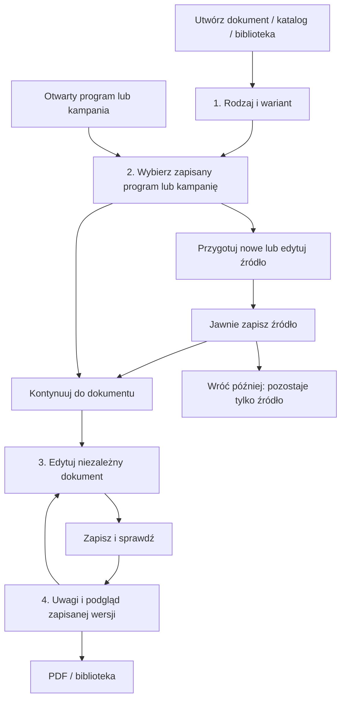

# DOC-FLOW-004 — jeden proces tworzenia dokumentu

Stan: implementacja lokalna na `dev`, 2026-10-28. Bez commitowania, push ani wdrożenia.
Baza zmian: `033e63914a3fec8e62daf4af33164d34fb02b29c`.

## Instrukcja dla Adriana

1. Otwórz `/documents/demo` i **Utwórz dokument**. Wybierz ofertę, rozpiskę pilota
   lub marketing. Dla marketingu wybierz **Nowe kierunki** lub **Kolekcję tematyczną**.
2. Wybierz zapisany program lub kampanię. Sprawdź podsumowanie: kierunek, dni,
   termin, kategorie i pochodzenie. Lista nie wybiera pierwszego programu za Ciebie.
   Filtry pozwalają pokazać inne kategorie, nieprzypisane, DEMO i jawnie TEST.
3. Jeśli program wymaga poprawy, użyj **Edytuj program wycieczki**. Jeśli tworzysz
   nowy, wybierz **Utwórz nową wycieczkę** i **Przygotuj program**. Uzupełnij
   rzeczywiste dni, opisy i atrakcje, kierunki oraz daty w istniejącym edytorze.
4. Kliknij **Zapisz program wycieczki**. Dopiero **Kontynuuj do dokumentu** tworzy
   niezależny dokument z zapisanej wersji programu. Możesz zamiast tego wybrać
   **Zapisz program i wróć później** — dokument wtedy nie powstaje.
5. W dokumencie uzupełnij tytuł, treść, warunki oferty albo dane operacyjne pilota.
   Podgląd działa na żywo. Zdjęcia, kadry, uwagi redakcyjne oraz układ i sekcje
   są dostępne w opisanych grupach. Rozwijanie grup nie kasuje wpisanej treści.
6. **Zapisz dokument** zachowuje zmiany. **Zapisz i sprawdź** zapisuje je i otwiera
   etap sprawdzenia. Po błędzie pozostajesz w edytorze z wpisanymi zmianami.
7. Sprawdź uwagi i podgląd zapisanej wersji. **Podgląd i eksport PDF** otwiera
   dotychczasowy podgląd z drukowaniem; dla marketingu możesz wybrać A4 lub social.
   Eksport nie oznacza archiwizacji pliku PDF na serwerze ani zatwierdzenia oferty.
8. Wróć do biblioteki. **Otwórz / Edytuj** otwiera ten sam dokument; nie tworzy kopii.
   Osobne akcje biblioteki nadal obsługują kopię, status, archiwum i historię.

Zapis, kompletność pól i status biznesowy to trzy różne rzeczy. Liczba opisanych
dni oraz pochodzenie biznesowe nie potwierdzają cen, rezerwacji, praw do zdjęć ani
gotowości wyjazdu. Etap sprawdzenia nie nadaje automatycznie statusu „Gotowy”.

### Marketing i wejścia z innych ekranów

Nowa kampania wymaga wyboru wycieczek, a następnie przygotowania tytułu, tematu,
kontaktów, kolejności i materiałów w Studio kolekcji. **Zapisz kampanię** zapisuje
wspólną kolekcję; **Kontynuuj do dokumentu** tworzy jej niezależny dokument.
Późniejsza edycja dokumentu nie zmienia kampanii ani wycieczek.

Z otwartego programu lub kampanii wybierz rodzaj dokumentu i akcję tworzenia.
Ten sam ekran wyboru programu otworzy się z wybranym źródłem. Z biblioteki
**Nowy dokument** prowadzi do tego samego katalogu typów. Powrót do źródła
z niezapisanymi zmianami wymaga świadomego potwierdzenia porzucenia zmian.

## Co zmieniło się w procesie

Wcześniej nowy program z tytułem i pustymi dniami mógł od razu tworzyć dokument.
Wejścia z programu, katalogu i marketingu miały różne ekrany pośrednie.
Teraz wszystkie wejścia korzystają z jednego utworzenia dokumentu, a nowy program
lub kampania trafia najpierw do dotychczasowego edytora źródła.

## Nawigacja i stan

| Trasa w `/documents/demo` | Działanie |
| --- | --- |
| `#templates` lub brak hasha | Główny katalog „Utwórz nowy dokument”. |
| `#create-document/{template}/{variant}` | Wspólny wybór programu. |
| `#create-document/{template}/{variant}/{trip\|campaign}/{id}` | Ten sam wybór z konkretnym źródłem. |
| `#prepare-trip/{template}/{variant}/{new\|id}` | Istniejący edytor programu z kontekstem tworzenia. |
| `#prepare-campaign/{template}/{variant}/{new\|id}` | Istniejący edytor kampanii z kontekstem tworzenia. |
| `#edit-draft/{id}` | Edycja zapisanego dokumentu. |
| `#review-draft/{id}` | Sprawdzenie zapisanej wersji i istniejący PDF. |
| `#drafts`, `#drafts/{id}`, `#revisions/{id}` | Zachowane biblioteka, stary widok szczegółów i historia. |
| `#trips[/id]`, `#campaigns[/id]`, `#marketing/{id}` | Zachowane zarządzanie źródłami. |

`/hub` i granice modułów nie zmieniają się. Parametry `demo`, `attempt`, `rev`
niosą wybrany przykład DEMO oraz tożsamość próby utworzenia. Odświeżenie z ID
odczytuje serwer; nigdy nie traktuje lokalnego formularza jako zapisanego dokumentu.
Wstecz/Dalej działa między zapisanymi ekranami, zmiana formatu podglądu nie dodaje
wpisu do historii przeglądarki. Fokus po zmianie widoku trafia do nagłówka.
Podczas zapisu operacje na bieżącym widoku są blokowane; stare odpowiedzi odczytu
nie mogą zastąpić nowszej nawigacji.

`document-flow.js` przechowuje wyłącznie chwilowy kontekst i stan rozwinięcia grup.
Nie ma nowego frameworka, drugiego edytora ani zapisu danych w local/sessionStorage.

## Zapis, ponowienia i niezależność danych

- Nie ma autosave. Zapis programu/kampanii nie tworzy dokumentu.
- Nowe źródło i dokument mają stałe ID próby. Po niejednoznacznym błędzie
  sieciowym klient odczytuje ten sam obiekt i porównuje dane. Zgodny zapis
  jest uznawany za potwierdzony. Brak obiektu pozwala powtórzyć tę samą próbę.
  Brak możliwości potwierdzenia pokazuje ścieżkę **Sprawdź zapis**; nie należy
  rozpoczynać innej próby w nowym formularzu bez sprawdzenia poprzedniej.
- `POST /api/document-studio/drafts` przyjmuje opcjonalne `document_id`
  i dodatnią `source_revision`. Ten sam ID i zgodny zamiar zwracają istniejący
  dokument bez nowej rewizji; inny zamiar lub nieaktualne źródło daje 409.
  Wyścig tworzenia korzysta z istniejącego create-only magazynu i odczytu wyniku.
  Klienci pomijający nowe pola działają jak wcześniej.
- PUT zachowuje dotychczasowe optymistyczne sprawdzanie rewizji. Błąd nie czyści
  edytowanej treści ani nie przenosi do sprawdzenia. Sukces jest pokazywany dopiero
  po potwierdzeniu zapisu lub zgodnym odczycie. Błąd odświeżenia licznika po zapisie
  nie jest zgłaszany jako nieudany zapis.
- Dokument nadal zawiera istniejące niezależne kopie danych źródła. Zmiana źródła
  po utworzeniu nie synchronizuje dokumentu i historii. Klasyfikacja poufności,
  usuwanie danych wewnętrznych z ofert i zasady dostępu pozostają dotychczasowe.
- Sprawdzenie otwiera istniejący endpoint podglądu konkretnej zapisanej rewizji.
  Osadzony widok pobiera HTML tego endpointu do `srcdoc`, tak jak istniejące
  edytory. Zachowuje chmurowy `X-Frame-Options: DENY`; zmiana formatu wymienia
  ramkę bez dopisywania pozycji do historii przeglądarki. Nie powstał nowy
  renderer ani archiwum PDF. Modele zapisu, JSON/GCS, Firestore,
  IAP, Terraform i pipeline wdrożenia nie były zmieniane.

## Weryfikacja

Wszystko wykonano na danych syntetycznych w tymczasowych lokalnych magazynach
lub izolowanych adapterach chmurowych, bez żądań do zewnętrznych usług.

| Kontrola | Wynik |
| --- | --- |
| `.venv/Scripts/python.exe -m pytest -q` | 788 passed, 1 warning; 60,89 s. |
| Nowe testy `test_document_creation_flow.py` | 28 przypadków: JSON/GCS, 8 typów/2 warianty, stałe ID, wersja źródła, wyścig, ponowienia i stary klient. |
| `browser_document_studio_smoke.py` | PASS: restart procesu, katalog, biblioteka/historia/kopie/archiwum, reliability, DOC-UX-002, nowy flow i macierz PDF. |
| `browser_trip_documents_smoke.py` | PASS: 6 rzeczywistych PDF, 2/10/15 dni, język polski, dane wewnętrzne, zapis i restart. |
| `browser_marketing_smoke.py` | PASS: 8 rzeczywistych PDF, 1/3/8 kierunków, oba warianty, kadry, blokada przy braku CTA, restart. |
| `browser_cloud_demo_smoke.py` | PASS: uwierzytelniony Hub, źródła, edytory, podglądy i pozostałe moduły. |
| `creation_flow_qa.py` | PASS: istniejący/nowy program, kampania, utracone odpowiedzi po zapisie, timeout, retry, 409, podwójne kliknięcie, Wstecz/Dalej/refresh, niezależność i responsywność. |
| Dotychczasowa macierz `pdf_quality_qa.py` | 16/16 PASS bez zmiany renderera; tekst, paginacja, A4/social i diagnostyka. |
| `python -m scripts.gcp.ci offline` | PASS: kontrakty źródeł i podglądów; bez poświadczeń ani wdrożenia. |
| `node --check` zmienionych skryptów i `git diff --check` | PASS. |

Nowy test przeglądarkowy jest włączony do dotychczasowego smoke Studio.
Istniejące testy przeglądarkowe dopasowano do jawnego przygotowania źródła
i nowych etykiet, zachowując sprawdzanie utrwalonych danych i numerów rewizji.

### Zrzuty głównych etapów

Zrzuty z rzeczywistego Chromium, lokalne i ignorowane przez Git:

- [Rodzaj — desktop](../local-data/creation-flow-qa/01-type-desktop.png),
  [mobile](../local-data/creation-flow-qa/01-type-mobile.png),
  [laptop](../local-data/creation-flow-qa/01-type-laptop.png),
  [tablet](../local-data/creation-flow-qa/01-type-tablet.png).
- [Wybór programu](../local-data/creation-flow-qa/02-source-desktop.png),
  [przygotowanie dni i atrakcji](../local-data/creation-flow-qa/02-prepare-program.png).
- [Edycja dokumentu](../local-data/creation-flow-qa/03-document-editor.png).
- [Sprawdzenie — desktop](../local-data/creation-flow-qa/04-review-desktop.png),
  [mobile](../local-data/creation-flow-qa/04-review-mobile.png).

## Pliki implementacji

- `frontend/document-flow.js` — wspólne kroki, potwierdzanie zapisu, informacja
  o źródle, grupowanie edytorów i fokus.
- `frontend/studio.js` — jeden zapis nowego dokumentu, przygotowanie źródeł,
  trasy, podsumowania i sprawdzenie zapisanej wersji.
- `frontend/trip-editor.js`, `frontend/marketing-editor.js` — istniejące edytory,
  spójne akcje, niezależność dokumentu i jawne kontynuowanie z kampanii.
- `frontend/index.html`, `frontend/studio.css`, `frontend/library.js` — menu,
  dostępne i responsywne kroki oraz etykiety biblioteki.
- `app/document_studio/api.py`, `app/document_studio/service.py` — opcjonalne
  zabezpieczenia tworzenia i udostępnienie nowego lokalnego skryptu.
- `tests/test_document_creation_flow.py`, `tests/creation_flow_qa.py` — nowe testy.
- `tests/browser_document_studio_smoke.py`, `tests/browser_trip_documents_smoke.py`,
  `tests/browser_marketing_smoke.py`, `tests/browser_cloud_demo_smoke.py`,
  `tests/studio_catalog_qa.py`, `tests/source_ux_qa.py`, `tests/reliability_qa.py`
  — aktualizacja nawigacji testów z zachowaniem regresji.
- `docs/DOCUMENT_STUDIO.md`, niniejszy raport — instrukcje i ograniczenia.

Ścieżki `frontend/...` powyżej są względem `app/document_studio/`.

## Ręczna kontrola DEV po osobno autoryzowanym wdrożeniu

Ta lista jest instrukcją przyszłej kontroli; nie oznacza wykonania operacji na DEV.
Używaj tylko jawnie oznaczonych danych syntetycznych i zatwierdzonego konta.

1. Z Hub otwórz Studio. Sprawdź katalog i wszystkie osiem typów, w marketingu oba warianty.
2. Z biblioteki programu rozpocznij ofertę: program ma być wybrany, bez dodatkowej kopii.
3. Przygotuj nowy Self-Guide z dniem i atrakcją. Przed zapisem nie powinien istnieć;
   po zapisie ma istnieć wyłącznie program. Sprawdź refresh i **Wróć później**.
4. Kontynuuj do dokumentu. Zmień źródło osobno i upewnij się, że dokument się nie zmienił.
5. Utwórz kampanię z kilkoma wycieczkami, zmień kolejność, zapisz, dopiero potem dokument.
6. W edytorze zmień treść i rozwiń/zwiń sekcje. Odrzuć odejście z niezapisanymi zmianami.
7. W dwóch kartach spowoduj konflikt zapisu. Starsza karta ma zachować treść i pokazać błąd.
8. Sprawdź zapis, uwagi, A4/social i PDF. Brak CTA ma blokować druk; status nie zmienia się sam.
9. Otwórz stary dokument z biblioteki; sprawdź zdjęcia, sekcje, zapis, historię, kopię i archiwum.
10. Sprawdź Wstecz/Dalej i odświeżenie oraz widoki 1440, 1280, 768 i 390 px.

## Ograniczenia

- Niezapisany formularz nie jest trwałym dokumentem. Potwierdzone porzucenie
  zmian lub odświeżenie przed zapisem może je utracić; nie dodano automatycznego
  odtwarzania roboczej treści ani synchronizacji między kartami.
- Idempotencja dotyczy tego samego ID próby, nie różnych kart ani nowo rozpoczętych
  formularzy. Nie jest globalnym systemem transakcji. Kontrola wersji źródła działa
  w chwili jego odczytu, bez nowej transakcji między magazynem źródeł i dokumentów.
- Nazwa kampanii w informacji o źródle pochodzi z dostępnego katalogu źródeł;
  gdy źródła brakuje, pozostaje nazwa z danych dokumentu. Nie dodano nowego pola
  historycznej nazwy źródła ani migracji starych dokumentów.
- Podgląd wymaga istniejących uprawnień. Nieudane pobranie walidacji jest widoczne
  i nie jest przedstawiane jako potwierdzenie kompletności. Nie wprowadzono nowych ról.
- Testy chmurowe używają izolowanych adapterów; nie zastępują kontroli wdrożenia
  w rzeczywistym IAP/GCS. Nie wdrażano zmian ani nie modyfikowano danych użytkowników.
