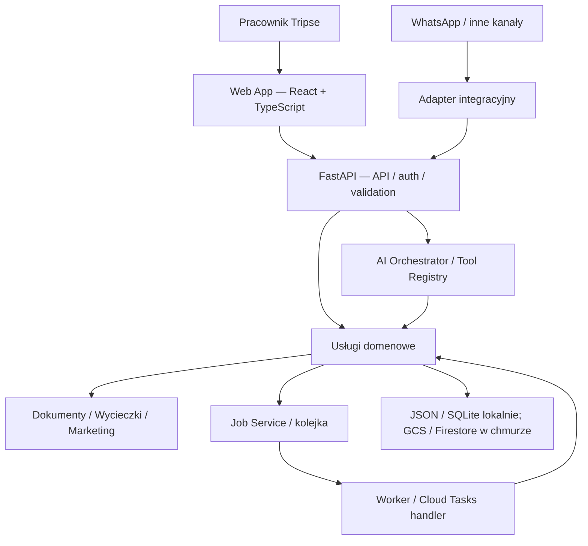
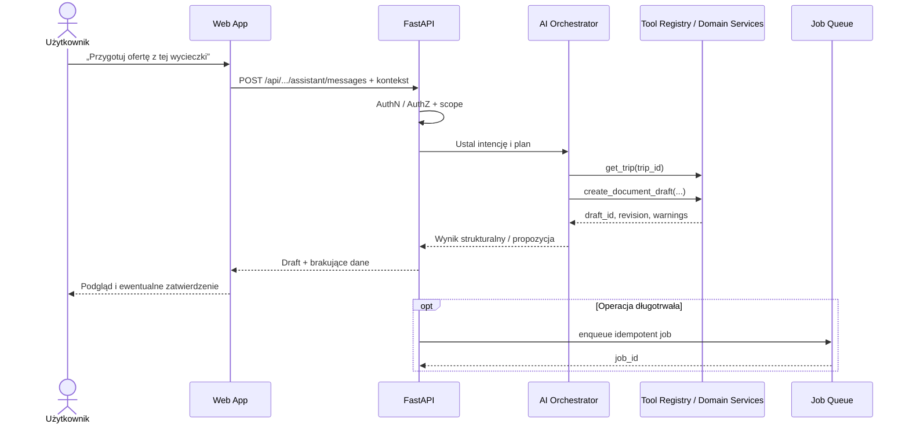

# TRIPSE — Architecture Blueprint (Web App + API + AI)

> **Status:** `PROPOSED` / dokument kierunkowy, niezatwierdzona decyzja architektoniczna (ADR).  
> **Data:** 2026-10-29  
> **Repozytorium:** [`piotrbarabasz/tripse-ai-demo`](https://github.com/piotrbarabasz/tripse-ai-demo)  
> **Docelowa lokalizacja:** `docs/architecture/TRIPSE_ARCHITECTURE_BLUEPRINT.md`  
> **Horyzont:** działające demo → wewnętrzna web app → panel operacyjny sterowany również przez AI.

## 0. Jak korzystać z tego dokumentu

Ten plik jest **punktem odniesienia (North Star)** dla kolejnych analiz, ADR-ów, promptów implementacyjnych i migracji. **Nie stanowi polecenia natychmiastowego rewrite'u** ani potwierdzenia, że wszystkie poniższe technologie zostały zaakceptowane.

Każda przyszła zmiana architektoniczna powinna:

1. wskazać sekcje tego blueprintu, których dotyczy;
2. zweryfikować aktualny stan gałęzi i istniejące kontrakty/testy (ten plik nie zastępuje audytu kodu);
3. oddzielić **stan obecny**, **propozycję** i **wdrożenie**;
4. dla istotnych lub trudnych do odwrócenia decyzji utworzyć ADR w istniejącym `docs/adr/`;
5. wskazać migrację, kompatybilność, testy, rollback i definicję ukończenia.

W razie sprzeczności dokument kierunkowy **nie nadpisuje** działających kontraktów, decyzji bezpieczeństwa, udokumentowanych ograniczeń środowiska ani dowodów wdrożenia. Najpierw przeprowadzić przegląd i zatwierdzić zmianę.

---

## 1. Wizja produktu

TRIPSE ma ewoluować z demonstracji oddzielnych funkcji w **jedną wewnętrzną aplikację webową do pracy biura podróży**. Użytkownik wykonuje działania ręcznie w interfejsie lub zleca je asystentowi AI; oba kanały korzystają z **tych samych usług domenowych**.

### Główne możliwości docelowe

- **Workspace / Hub:** spójna nawigacja, status środowiska i modułów, skróty do działań.
- **Trip Planner / Trip Catalog:** planowanie, przegląd, edycja i ponowne wykorzystanie danych wycieczek.
- **Document Studio:** oferty, materiały dla pilotów, wersje robocze, podglądy i eksport.
- **Marketing:** kampanie i warianty materiałów bazujące na danych wycieczek.
- **Automations:** zadania, statusy, historia, wynik, błędy, retry i zatwierdzenia.
- **AI Assistant:** język naturalny jako alternatywne wejście do istniejących operacji.
- **Integrations:** np. WhatsApp jako opcjonalny adapter wejściowy, niezależny od UI.

### Zasady produktowe

- **UI-first, AI-enabled:** zwykły interfejs musi pozostać użyteczny bez modelu AI.
- **Human-in-the-loop:** AI może przygotowywać szkice; działania o skutkach zewnętrznych wymagają autoryzacji i odpowiednich potwierdzeń.
- **Single source of business logic:** reguły dokumentów, uprawnienia i operacje pozostają po stronie backendu.
- **Demo-safe by default:** sztuczne dane, jawne etykiety MOCK, brak domyślnych płatnych wywołań i przypadkowego ujawniania danych.
- **Ewolucja zamiast rewrite'u:** moduły przenosimy stopniowo, bez zatrzymywania obecnych ścieżek.

### Poza zakresem pierwszej migracji

Pełny CRM/ERP, marketplace rezerwacyjny, portal SEO/SSR, mikroserwisy per moduł, wieloagentowa orkiestracja, nowe repozytorium dla każdego komponentu i automatyczna migracja wszystkich danych historycznych.

---

## 2. Punkt startowy — stan repozytorium (do ponownego audytu przed pracami)

Na podstawie przeglądu gałęzi `dev` 2026-10-29:

| Obszar | Obecny kierunek / implementacja | Konsekwencja |
|---|---|---|
| Backend | FastAPI + Pydantic, routery planera, Document Studio, Hub, viewer i demo chat | Zachować i porządkować modułowo, nie wymieniać frameworka |
| Frontend | HTML/CSS/Vanilla JS w `app/static/`, `app/hub_frontend/`, `app/document_studio/frontend/` | Wprowadzić wspólną powłokę i komponenty React, migrować przyrostowo |
| Lokalny storage / jobs | JSON, SQLite, osobny worker | Zachować lokalne tryby i izolację danych |
| Cloud demo | Prywatne DEV/PROD z IAP, GCS, Firestore i Cloud Tasks | Nie naruszać obecnej granicy tożsamości i danych |
| Deployment | Cloud Run, istniejący Docker/CI/CD, osobne środowiska | Preferować początkowo wspólny origin i jeden serwis na środowisko |
| Dokumenty | Istniejące modele Pydantic, template registry, rewizje, HTML/print/PDF | Migrować UI bez przepisywania silnika dokumentowego |
| Integracje | Planer, mapy, lokalny symulator, opcjonalny WAHA | Pozostawić interfejsy integracyjne po stronie API |

**Uwaga:** stan CI/CD i dostępności opisują istniejące raporty release/QA; nie oznacza to gotowości do obsługi rzeczywistych danych klientów, potwierdzenia logowania każdego konta ani produkcyjnego uruchomienia LIVE/WhatsApp.

**Dokumenty bazowe do sprawdzenia podczas implementacji:** `README.md`, `docs/ROUTING.md`, `docs/HUB.md`, `docs/DOCUMENT_STUDIO.md`, `docs/CLOUD_PARITY_AUDIT.md`, `docs/RELEASE_2026_10_28.md`, `docs/GITHUB_CICD.md`, `docs/adr/README.md`. Zachować historię ADR i evidence.

---

## 3. Rekomendowana architektura docelowa

### 3.1. Styl systemu

**Modularny monolit backendowy + jedna Single Page Application (SPA)**, przy zachowaniu niezależnego wykonania zadań asynchronicznych. Logiczne granice domenowe są wyraźne, ale nie wymuszamy fizycznego podziału na mikroserwisy.



**Wymaganie graniczne:** UI, agent i integracje **nie implementują osobno** tych samych reguł biznesowych. Wywołują wspólne, autoryzowane use case'y.

### 3.2. Rekomendowany stack (do osobnego ADR)

| Warstwa | Preferowana opcja | Status / zastrzeżenie |
|---|---|---|
| UI | React + TypeScript + Vite | Rekomendacja, wymaga ADR i krótkiego proof-of-concept |
| Routing | React Router | Klientowe trasy nowej aplikacji pod `/app/*` |
| Styl/UI | Tailwind CSS + shadcn/ui | Preferencja, ocenić dostępność, utrzymanie i spójność brandingu |
| Server state | TanStack Query | Fetch/cache/statusy, bez dublowania całego stanu w store |
| Formularze | React Hook Form + Zod | Walidacja UX; backend Pydantic pozostaje autorytatywny |
| Klient API | OpenAPI → generowane typy TypeScript | Zgodność kontraktów i ograniczenie ręcznej duplikacji |
| Złożony diagram/edytor | React Flow | Tylko jeżeli wymagania tego uzasadnią |
| Backend | FastAPI + Pydantic | Zachować |
| Zadania | istniejący worker lokalny / Cloud Tasks w chmurze | Zachować, ujednolicić kontrakt statusów |
| Storage | lokalne adaptery + GCS/Firestore | Nie zmieniać tylko z powodu migracji UI |
| AI | moduł orkiestracji w backendzie | Na start pojedynczy orchestrator + jawny rejestr narzędzi |

**Nie wprowadzamy na starcie** Next.js, SSR, osobnego Node API/BFF, Redux ani LangGraph wyłącznie „na zapas”. Każde dodatkowe narzędzie musi rozwiązywać konkretny problem.

---

## 4. Granice odpowiedzialności

### 4.1. UI (`docs/ui/`)

Odpowiada za: układ i nawigację, interakcje, formularze, prezentację danych, lokalny stan edycji, cache zapytań, stany `loading/error/empty`, dostępność, ochronę użytkownika przed przypadkową akcją, prezentację wyników i postępu.

**Nie odpowiada za:** trwałą autoryzację, reguły domenowe, bezpośrednie wywołania OpenAI/Google server-side, sekrety, zapisy do storage, wykonanie zadań, generowanie krytycznych identyfikatorów uprawnień, samodzielne zatwierdzanie działań AI.

### 4.2. API (`docs/api/`)

Odpowiada za: uwierzytelnianie i autoryzację po stronie serwera, modele Pydantic, use case'y, trwałe operacje, wersjonowanie, idempotencję, kolejki, integracje, kontrolę kosztów, audyt, wykonanie narzędzi AI i egzekwowanie zasad bezpieczeństwa.

### 4.3. Wspólna architektura (`docs/architecture/`)

Opisuje granice komponentów, przepływy między modułami, decyzje o deploymentach, kontrakty między UI/API, migracje, ryzyka i wymagania przekrojowe.

### 4.4. Infrastruktura (`docs/infra/`, opcjonalnie w późniejszym etapie)

Opisuje Cloud Run, GCP IAM/IAP, CI/CD, buildy, koszty, obserwowalność, backup, rollback i odtwarzanie. Dokumentacja infrastruktury **nie powinna być mylona** z kontraktami UI/API.

---

## 5. Plan docelowej struktury dokumentacji

**Propozycja docelowa — nie wykonywać od razu hurtowych przenosin obecnych plików.**

```text
docs/
├── README.md                              # indeks dokumentacji i statusy
├── architecture/
│   ├── TRIPSE_ARCHITECTURE_BLUEPRINT.md   # ten dokument — wizja/north star
│   ├── SYSTEM_CONTEXT.md                  # przepływy i granice
│   ├── INTEGRATION_CONTRACTS.md           # kontrakty między warstwami
│   └── MIGRATION_PLAN.md                  # migracja i rollback
├── ui/
│   ├── README.md                          # indeks UI
│   ├── UI_ARCHITECTURE.md                 # React, routing, state/data flow
│   ├── DESIGN_SYSTEM.md                   # tokeny, komponenty, UX/a11y
│   ├── API_CLIENT.md                      # OpenAPI, errors, polling/streaming
│   └── features/
│       ├── HUB.md
│       ├── TRIP_PLANNER.md
│       ├── DOCUMENT_STUDIO.md
│       ├── MARKETING.md
│       └── ASSISTANT.md
├── api/
│   ├── README.md                          # indeks API
│   ├── API_ARCHITECTURE.md                # moduły i zależności
│   ├── DOMAIN_MODEL.md                    # dane, reguły, ownership
│   ├── API_CONTRACTS.md                   # public/private endpoints
│   ├── STORAGE_AND_JOBS.md                # persistence, Cloud Tasks
│   ├── ASSISTANT_AND_TOOLS.md             # tools, approval, audyt
│   └── SECURITY.md                        # authn/authz, tenant/data scope
├── infra/                                 # FUTURE / opcjonalnie
│   ├── DEPLOYMENT.md
│   └── OBSERVABILITY.md
├── adr/                                   # istniejące ADR-y — zachować
├── document-system/                       # istniejąca dokumentacja domenowa
├── tracking/                              # istniejący tracking
└── ...                                    # istniejące instrukcje i audyty
```

### Podział treści i źródła prawdy

| Pytanie | Dokument wiodący |
|---|---|
| „Dlaczego robimy web app i jakie są granice?” | `docs/architecture/TRIPSE_ARCHITECTURE_BLUEPRINT.md` |
| „Jak zbudowany jest frontend?” | `docs/ui/UI_ARCHITECTURE.md` |
| „Jak wyglądają komponenty, formularze, nawigacja?” | `docs/ui/DESIGN_SYSTEM.md`, `docs/ui/features/*` |
| „Co robi endpoint i kto może go wywołać?” | `docs/api/API_CONTRACTS.md`, OpenAPI, testy kontraktowe |
| „Jak działa use case i zapis danych?” | `docs/api/DOMAIN_MODEL.md`, `docs/api/STORAGE_AND_JOBS.md` |
| „Jak AI uruchamia operacje?” | `docs/api/ASSISTANT_AND_TOOLS.md` |
| „Jak wdrażamy, zabezpieczamy i przywracamy usługę?” | dokumenty infra + aktualne runbooki |
| „Dlaczego wybrano rozwiązanie X zamiast Y?” | ADR w `docs/adr/` |

### Migracja istniejących dokumentów

- **Nie kasować i nie przenosić automatycznie** `docs/HUB.md`, `docs/ROUTING.md`, `docs/DOCUMENT_STUDIO.md`, `docs/document-system/*`, release reports i ADR.
- Nowe dokumenty `docs/ui/*` i `docs/api/*` mogą początkowo **linkować do istniejących źródeł** zamiast kopiować ich treści.
- Po zmapowaniu odpowiedzialności przenosić tylko aktualne specyfikacje; raporty incydentów, pomiary, evidence i historyczne ADR pozostają bez zmian.
- Podczas przenosin zapewnić przekierowania/odnośniki i naprawić linki względne; nie wprowadzać dwóch sprzecznych definicji kontraktu.
- W przyszłości `docs/README.md` powinien być główną mapą dokumentacji z oznaczeniem `implemented / proposed / deprecated`.

---

## 6. Proponowana struktura kodu (po migracji)

```text
tripse-ai-demo/
├── frontend/                              # nowy projekt Vite
│   ├── src/
│   │   ├── app/                           # router, providers, app shell
│   │   ├── features/
│   │   │   ├── dashboard/
│   │   │   ├── trips/
│   │   │   ├── documents/
│   │   │   ├── marketing/
│   │   │   ├── automations/
│   │   │   └── assistant/
│   │   ├── components/ui/                 # reużywalne primitive'y
│   │   ├── components/layout/             # shell, sidebar, header
│   │   ├── api/                           # klient, typy z OpenAPI
│   │   ├── hooks/
│   │   └── lib/
│   ├── package.json
│   └── vite.config.ts
├── app/                                    # FastAPI — pozostaje
│   ├── main.py
│   ├── document_studio/                   # istniejąca logika domenowa
│   ├── assistant/                         # przyszła orkiestracja
│   └── ...                                # obecne moduły
├── docs/
├── infra/
├── tests/
└── Dockerfile
```

W przyszłym refaktorze backendu można wydzielić np. `app/modules/trips`, `app/modules/documents`, `app/modules/marketing`, `app/modules/automations` i `app/integrations`. **Nie robić tego tylko po to, żeby zmienić nazwy katalogów.** Najpierw uzgodnić granice domenowe i zależności.

### Zasady frontendowe

- Organizacja **feature-first**, a nie jeden ogromny folder komponentów.
- Wspólne UI primitive'y i layout; logika domenowa blisko danej funkcji.
- Dane serwerowe przez TanStack Query; lokalny stan prostymi mechanizmami React; globalny store dopiero gdy pojawi się rzeczywista potrzeba.
- Typy odpowiedzi generowane z OpenAPI; nie utrzymywać ręcznie zdublowanych kontraktów.
- Walidacja Zod dla UX nie zastępuje walidacji Pydantic.
- Edytory i podglądy dokumentów migrować **oddzielnie**; backend zachowuje autorstwo wersji i reguł danych.
- Nowe komponenty muszą wspierać klawiaturę, dostępność, responsywność, stany błędów i testowalność.

---

## 7. Routing i strategia migracji UI

### Wersja przejściowa

- Obecne ścieżki pozostają aktywne: `/` → `/hub`, `/planner`, `/documents/demo`, `/demo/chat`, `/trip/{token}` oraz istniejące API.
- **Nowa SPA zaczyna pod `/app/*`**, bez przejmowania tras starego UI.
- W pierwszej fazie `/app` zawiera App Shell, nowy Hub i opcjonalnie eksperymentalne widoki, ale nie wyłącza starego panelu.
- Przekierowanie wejścia głównego na nowy panel dopiero po testach funkcji, dostępów i rollbacku.
- Backend musi kierować tylko trasy **należące do SPA** do `index.html`; nie może przez fallback przechwytywać `/api/*`, `/internal/*`, `/health`, `/trip/*` ani innych istniejących endpointów.
- Statyczne zasoby Vite muszą mieć poprawne `base`, hashowane nazwy/cache i jawne zasady CSP.

### API i wersjonowanie

Nie przeprojektowywać istniejących endpointów wyłącznie dla nowego UI. Uzgodnić standard dla **nowych** endpointów, np. `/api/v1/...`, a istniejące zachować jako kompatybilne lub zmapować adapterem. Wersjonowanie musi wynikać z rzeczywistego kontraktu, nie tylko estetyki URL.

Dla długotrwałych operacji: `POST` tworzy zadanie, zwraca stabilny identyfikator/status, a UI odczytuje postęp przez polling; ewentualny SSE rozważyć dopiero gdy produkt wymaga częstszych aktualizacji i rozwiązano kwestie auth/reconnect/proxy.

---

## 8. Asystent AI jako kanał operacyjny

### Założenie

Asystent może być pełnoekranową funkcją lub wysuwanym panelem kontekstowym, ale **nie może być jedynym interfejsem** do istotnych operacji. Dostaje aktualny kontekst (np. `trip_id`, `document_id`, wersję i zakres uprawnień), nie surowy dostęp do wszystkiego.

### Docelowy przebieg



### Bezpieczeństwo i niezawodność narzędzi

- Narzędzia są **jawnie zarejestrowanymi use case'ami** (np. `get_trip`, `create_document_draft`, `update_document_section`, `prepare_campaign`), ze schematami i walidacją argumentów.
- Backend sprawdza role, właściciela/zakres danych i uprawnienia **dla każdego wywołania narzędzia**. Model nie jest źródłem uprawnień.
- Brak ogólnego dostępu AI do SQL, dowolnego HTTP, plików i sekretów.
- Rozdzielić operacje **read**, **draft/write** i **external/high-impact**. Wysyłki/publikacje i nieodwracalne akcje wymagają osobnego uprawnienia i potwierdzenia.
- Zapisywać historię: kto, kiedy, jakie narzędzie, identyfikator zasobu, wynik, błąd i koszt — bez przypadkowego logowania sekretów lub nadmiaru danych osobowych.
- Zapewnić idempotency keys, limit czasu, limity kosztów, retry i obsługę częściowych awarii.
- Nie wprowadzać multi-agentów ani orkiestratora grafowego przed potwierdzeniem korzyści na realnym use case.
- Ten sam zestaw usług domenowych może obsługiwać UI, asystenta i WhatsApp; każdy kanał ma własny model tożsamości i uprawnień.

**Proponowane pierwsze narzędzie AI:** stworzenie edytowalnego draftu dokumentu z istniejącego planu wycieczki z jawnym raportem brakujących pól. Bez automatycznego wysyłania do klienta.

---

## 9. Dane, asynchroniczność i kontrakty

- Utrzymać podział środowisk oraz storage: lokalne JSON/SQLite/worker vs cloud GCS/Firestore/Cloud Tasks.
- Nie przenosić trwałego stanu aplikacji do pamięci instancji Cloud Run ani do localStorage jako źródła prawdy.
- Zachować modele domenowe, rewizje, CAS / ochronę przed nadpisaniem i snapshoty dokumentów.
- Przy operacjach asynchronicznych zdefiniować wspólny kontrakt statusów (`queued`, `running`, `completed`, `failed`), identyfikator, data utworzenia, wynik/błąd oraz idempotencję. Rozszerzenia statusów muszą być kompatybilne z istniejącymi klientami.
- Oddzielić **dane wejściowe**, **wyniki jobów**, **pliki/obrazy**, **przekazane konwersacje AI** i **logi/audit trail** — mają różne zasady retencji i dostępu.
- Docelową bazę relacyjną wybierać dopiero po udokumentowaniu przypadków wymagających transakcji między agregatami, indeksów i raportowania; sam frontend nie uzasadnia migracji storage.

---

## 10. Hosting, auth i granice publiczne

### Faza początkowa

**Jeden serwis Cloud Run na środowisko** może nadal dostarczać FastAPI oraz statyczny build Vite pod wspólnym originem. Nowy frontend nie wymaga serwerowego renderowania Node.js. Zachować obecne środowiska DEV/PROD, promocję przetestowanego obrazu i jawne tryby mock/cloud.

### Wymagania

- IAP/Cloud Run pozostaje granicą wejścia do prywatnego panelu, a FastAPI egzekwuje tożsamość/uprawnienia operacyjne. Nie opierać bezpieczeństwa na samym ukryciu przycisków czy nazw hostów.
- Zachować oddzielne konta usług, zasoby danych, sekrety, polityki IAM, smoke testy i rollback.
- Nie wystawiać prywatnych zasobów/endpointów przez publiczny StaticFiles ani nie umieszczać server-side keys w bundlu Vite.
- `readonly_demo` pozostaje osobnym, ograniczonym kontraktem publicznego podglądu; nie podłączać go automatycznie do wszystkich tras nowej SPA.
- Przy SPA zweryfikować IAP, auth cookies, CSP, same-origin writes, deep links, caching, cache busting i zachowanie po wygaśnięciu sesji.
- LIVE AI, realny WhatsApp, dane klientów i operacje płatne mają **osobne bramki odbiorowe**. Sukces trybu mock nie oznacza odbioru LIVE.

Osobny hosting frontendu (np. Firebase Hosting), SSR albo niezależne serwisy rozważyć dopiero po wykazaniu konkretnej potrzeby i przeglądzie uwierzytelniania oraz kosztów utrzymania.

---

## 11. Fazy wdrażania — bez dużego rewrite'u

| ID | Faza / rezultat | Granica zakończenia |
|---|---|---|
| `ARCH-001` | Aktualny audyt UI/API/routingu, spis istniejących endpointów, zależności i ryzyk | Zweryfikowana mapa stanu `dev/master`, udokumentowane ograniczenia |
| `DOCS-001` | Indeksy i szablony `docs/ui`, `docs/api`, `docs/architecture` | Dokumenty połączone linkami, bez duplikacji starych kontraktów |
| `ADR-FE-001` | Decyzja React/Vite, hostowania, routingu i sposobu integracji | ADR z alternatywami, konsekwencjami i planem wycofania |
| `FRONT-001` | Skeleton React/TS/Vite, App Shell, routing `/app/*` i design tokens | Lokalny build, testy, brak regresji obecnego UI |
| `API-001` | Minimalny, typowany klient OpenAPI, obsługa auth/błędów i testy kontraktowe | Działające integracje bez ręcznie kopiowanych DTO |
| `FRONT-002` | Hub + globalna nawigacja na nowym froncie | Pełne przejścia do starych i nowych modułów |
| `FRONT-003` | Trip Planner i statusy zadań | Zachowana semantyka MOCK/LIVE i widok wyników |
| `FRONT-004` | Przyrostowa migracja Document Studio | CRUD, rewizje/konflikty, podgląd i druk bez regresji |
| `AI-001` | Backendowy agent + pierwszy jawny tool workflow | Tworzy draft, nie wysyła automatycznie, respektuje role |
| `AUTO-001` | Panel zadań / historia / approval / audyt | Użytkownik widzi co się wykonało i co wymaga decyzji |

**Kolejność nie jest sztywnym harmonogramem.** Document Studio można migrować fragmentami lub wcześniej, jeżeli jego utrzymanie jest bieżącym wąskim gardłem.

### Reguła każdego etapu

1. Mały zakres z testowalnym efektem.
2. Brak zmiany storage/CI/IAM, jeśli nie jest niezbędna.
3. Zachowanie kompatybilności starych URL/API albo jawna deprecjacja.
4. Testy jednostkowe, integracyjne, browser smoke, security i rollback adekwatne do zmiany.
5. Weryfikacja Cloud Run DEV przed promocją; nie deklarować gotowości PROD bez dowodów.

---

## 12. Minimalne kryteria akceptacji architektury

### Funkcjonalność

- Stary Hub, planer, dokumenty, podglądy, mapy, symulator i API działają podczas migracji.
- Nowa SPA ma spójną nawigację, czytelne loading/error/empty states i możliwość powrotu do starego UI.
- Edycja dokumentów nie traci rewizji, plików ani nie nadpisuje konfliktów.

### Bezpieczeństwo

- Prywatne trasy i dane nie są publiczne; role i scope są sprawdzane w API.
- Sekrety i klucze server-side nie trafiają do JS, HTML ani logów.
- AI nie wykonuje działań poza uprawnieniami ani nie publikuje bez potwierdzenia.

### Operacyjność

- Lokalny tryb mock nie wymaga chmurowych usług i nie generuje przypadkowych kosztów.
- Wdrożenie DEV i smoke działają dla nowej SPA, włącznie z deep links.
- Zachowane są CI/CD, separacja DEV/PROD, rollback i podstawowe logowanie błędów.

### Jakość

- Testy typów, lint, unit tests, integracyjne i scenariusze przeglądarkowe stanowią gate przed merge.
- Formularze i nawigacja działają na mobile oraz przy obsłudze klawiaturą.
- Przy zmianie kontraktów API aktualizuje się OpenAPI, testy i dokumentację we właściwej sekcji.

---

## 13. Otwarte decyzje do kolejnych ADR / discovery

| Decyzja | Preferowany kierunek | Co trzeba sprawdzić |
|---|---|---|
| Framework | React + TS + Vite | PoC i koszty migracji istniejących edytorów |
| Routing | SPA pod `/app/*` | Kolizje z obecnymi trasami, fallback i IAP |
| UI kit | Tailwind + shadcn/ui | Dostępność, wydruk, tokeny marki, maintainability |
| API schemas | OpenAPI codegen | Pokrycie schematów, stabilność generacji, workflow CI |
| Edytory dokumentów | React UI + istniejący backend/rendering | Snapshot/revision, formy sekcji, print CSS i PDF |
| AI UX | Panel kontekstowy + pełny ekran | Uprawnienia, statusy, propozycje i zatwierdzanie |
| Workflow engine | Obecne jobs/Cloud Tasks | Czy potrzeba bardziej złożonego DAG/approval engine |
| Baza danych | Obecne adaptery na start | Przyszłe transakcje, wyszukiwanie i raportowanie |
| Hosting UI | Wspólny Cloud Run origin | CSP, cache, bundling, dostęp publiczny/prywatny |
| Identity | IAP na fazę demo wewnętrznego | Gdy dojdą klienci, role i tożsamość poza IAP |

Nie blokować całej migracji decyzjami, które są potrzebne dopiero w późniejszych fazach.

---

## 14. Instrukcja dla przyszłych agentów / promptów implementacyjnych

> Korzystaj z `docs/architecture/TRIPSE_ARCHITECTURE_BLUEPRINT.md` jako dokumentu kierunkowego, a nie bezwzględnej instrukcji zmian. Najpierw przeczytaj aktualne `README.md`, `docs/adr/README.md`, `docs/ROUTING.md`, istotne specyfikacje modułów oraz kod na bieżącej gałęzi. Wskaż różnice między blueprintem a stanem repo. Zaproponuj najmniejszy bezpieczny etap, przygotuj ADR przy decyzji technologicznej, zaplanuj testy i rollback. Nie usuwaj istniejących ścieżek, danych ani zabezpieczeń. Nie zmieniaj Cloud Run/IAP/CI/CD poza zaakceptowanym zakresem. Oddziel plan od implementacji i nie raportuj niewykonanych czynności jako wdrożonych.

### Oczekiwany format przyszłego zadania architektonicznego

1. **Context / As-is** — potwierdzone pliki, endpointy, tryby działania.
2. **Problem / goal** — konkretny problem i mierzalny rezultat.
3. **Alternatives / trade-offs** — minimum dwie realistyczne opcje.
4. **Decision proposal** — co wybieramy, na jakich warunkach.
5. **Affected boundaries** — UI/API/storage/infra/security/docs.
6. **Migration** — małe kroki, kompatybilność, feature flags, rollback.
7. **Acceptance gates** — testy, demonstracja, security i dowody.
8. **Documentation updates** — aktualne `docs/ui`, `docs/api`, ADR i README.

---

## 15. Najbliższy krok (bez implementacji feature'ów)

**Przygotować `ARCH-001` + `DOCS-001`:**

- zweryfikować stan frontendów i listę tras/API na aktualnej gałęzi;
- utworzyć/uzupełnić indeksy `docs/README.md`, `docs/ui/README.md`, `docs/api/README.md` i `docs/architecture/README.md` (w razie potrzeby z odsyłaczami do starych dokumentów);
- przygotować pierwszy ADR z rekomendacją frameworka, routingu i hostowania, bez usuwania Vanilla JS;
- rozpisać mały PoC `/app` pokazujący shell, nawigację i bezpieczne wywołanie jednego istniejącego endpointu;
- nie zmieniać działającego deploymentu, dopóki nie przejdą adekwatne testy.

**Docelowy efekt:** dokumentacja gotowa do iteracyjnego projektowania UI/API i mały, odwracalny pierwszy krok techniczny.
