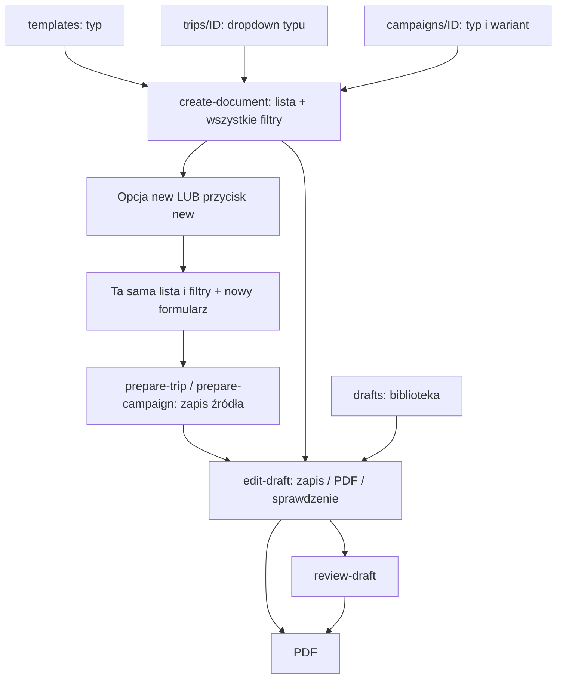
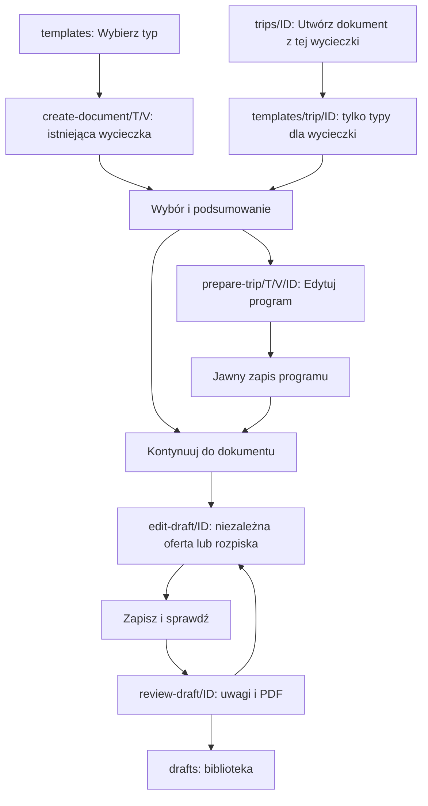
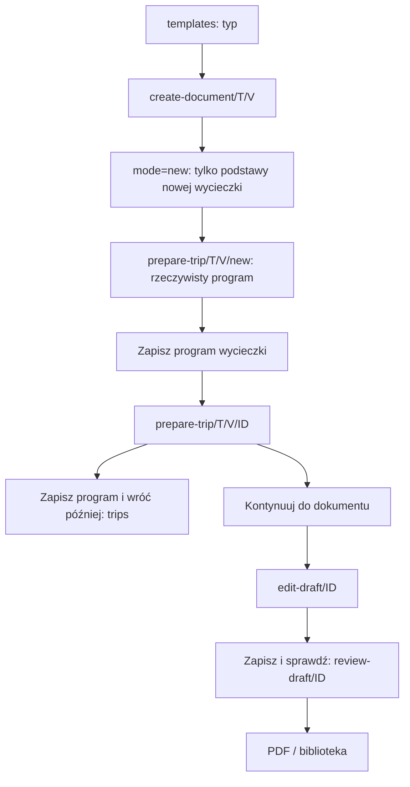
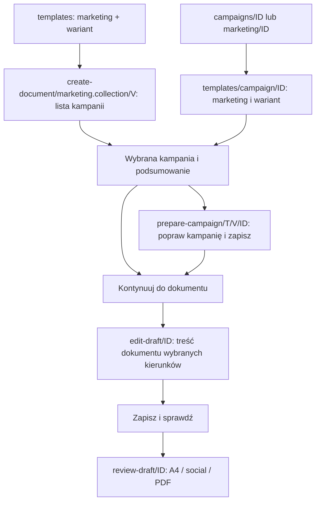
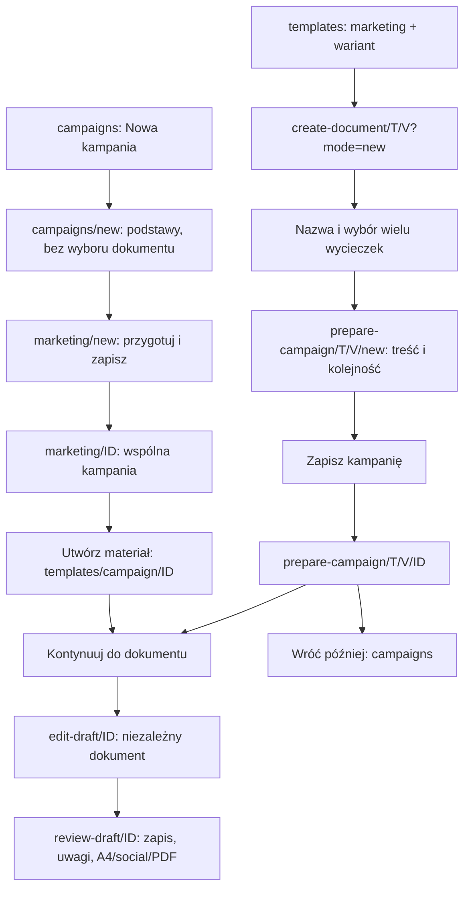
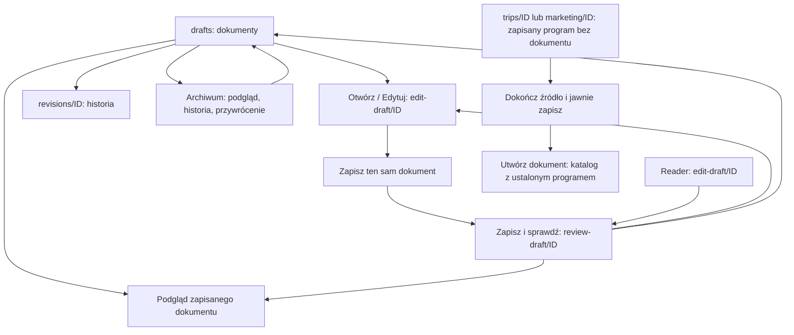

# DOC-FLOW-005 — audyt odpowiedzialności ekranów

Gałąź: `dev`. Bazowy HEAD: `b15388f8360ed28ea442dca5f8098b16bf19b898`
(`doc ux update`), czyste repozytorium. Zmiany pozostają lokalne, bez commit/push/deploy.
Audyt i projekt zapisano przed zmianami implementacji. Dowód przeglądarkowy:
`local-data/flow-structure-qa/before.json` oraz zrzuty `before-self-guide-*`.

## A. Podsumowanie i decyzja projektowa przed implementacją

Playwright odtworzył zgłoszony Self-Guide: opcja „+ Utwórz nowe źródło” oraz
przycisk „+ Utwórz nową wycieczkę” wykonują tę samą czynność. Po jej wybraniu
lista `size=6`, wszystkie filtry i formularz nowej wycieczki pozostają widoczne.
Testy 004 akceptowały ten układ, ponieważ sprawdzały możliwość kliknięcia oraz
zapis danych, nie brak nieodpowiednich kontrolek.

Docelowo wybór istniejącej i nowej wycieczki/kampanii będzie rozłącznym stanem
adresu. Lista będzie zawierała wyłącznie istniejące obiekty. Wyszukiwanie i
kategoria będą zwykłymi filtrami, a pochodzenie, DEMO/TEST i dodatkowe reguły
kategorii trafią do zamkniętych filtrów dodatkowych. Potwierdzenie wycieczki
przekazanej z jej własnego ekranu pokaże tylko jej podsumowanie i możliwość
świadomej zmiany. Wybór typu z tego ekranu odbędzie się w tym samym katalogu
z zachowaniem ID, bez domyślnego typu w dodatkowym selektorze.

Przygotowanie programu/kampanii wykorzysta istniejące edytory. W dokumencie nie
będzie wyszukiwarki nowych wycieczek ani ponownego wyboru kompozycji marketingu.
Eksport będzie na etapie sprawdzenia, a edytor zachowa zapis i przejście do
sprawdzenia. Biblioteki źródeł pozostaną odrębne od biblioteki dokumentów.
Nowa kampania z jej biblioteki nie powinna uruchamiać procesu nowego dokumentu.

### A1. Inwentarz BEFORE — kod i Chromium

| ID | Bieżąca trasa | Cel | Widoczne kontrolki | Akcje | Następne ekrany | Problem |
| --- | --- | --- | --- | --- | --- | --- |
| S01 | `#templates`, pusty hash | Landing i wybór typu | 8 kart, wariant marketingu, skróty bibliotek | Utwórz dokument, Otwórz zapisany | S02/S06/S09/S15 | Landing i katalog to jeden ekran; nazwa akcji sugeruje już utworzenie. |
| S02 | `#create-document/T/V` | Istniejąca wycieczka | Kategoria, wszystkie/nieprzypisane, search, origin, DEMO, TEST, duża lista, opcja new, przycisk new | Wybierz tę wycieczkę, Edytuj program | S03/S04/S10 | Dwa new, wszystkie filtry równorzędne, „źródło” zamiast wycieczka. |
| S03 | ta sama trasa, wybór `new` | Podstawy nowej wycieczki | S02 + nazwa, kierunek, dni, kategorie, origin | Przygotuj program | S04 | Jednoczesny wybór istniejącego i tworzenie nowego. |
| S04 | `#prepare-trip/T/V/new\|ID` | Nowy/istniejący program w procesie | Dane, kategorie, origin, dni, atrakcje, zapis, kontynuacja, pauza | Zapisz program, Kontynuuj do dokumentu | S02/S10/S06 | Brak ponownego typu — poprawne; origin dominuje; kontekst Back wymaga kontroli. |
| S05 | `#trips/ID`, `#trips/new` | Samodzielny program | S04 + drugi panel typu/ukrytego wariantu | Zapisz, Utwórz dokument z tej wycieczki | S02/S06 | Domyślnie wybrany typ; z ustalonym ID ponownie pełna wyszukiwarka. |
| S06 | `#trips` | Biblioteka programów | Filtry jak S02, karty | Nowa wycieczka, Otwórz | S05 | „Źródła” w pustym stanie, nadmiar filtrów. |
| S07 | `#create-document/marketing.collection/V[/campaign/ID]` | Wybór kampanii | Lista kampanii, origin, DEMO/TEST, dwa new | Wybierz kampanię, Edytuj | S08/S12 | Niepotrzebne filtry przy ustalonej kampanii. |
| S08 | S07 z `new` | Podstawy kampanii | S07 + tytuł, temat, wielowybór wycieczek ze wszystkimi filtrami | Przygotuj kampanię | S12 | Dwa różne selektory i formularz współistnieją. |
| S09 | `#campaigns` | Biblioteka kampanii | Filtry, karty | Nowa kampania / dokument, Otwórz | S07/S11 | Łączy tworzenie źródła z dokumentem. |
| S10 | `#edit-draft/ID`, oferta | Edycja oferty | Tytuł, treść, cena, wariantowe pola, zdjęcia, sekcje, podgląd | Zapisz, Zapisz i otwórz PDF, Zapisz i sprawdź, źródło | S14/S15/PDF | Dwie konkurujące drogi do eksportu. |
| S11 | `#campaigns/ID` | Szczegóły kampanii | Kolekcja, wycieczki, selektor typu (1 opcja), wariant | Edytuj kampanię, Utwórz materiał | S07/S12 | Wybór jednoelementowego typu i powtórna pełna lista kampanii. |
| S12 | `#prepare-campaign/T/V/new\|ID`, `#marketing/ID` | Kampania guided/standalone | Pola kampanii, wariant, pozycje, dodaj wycieczkę, kadry, upload, preview | Zapisz kampanię, Kontynuuj, pauza guided | S07/S13/S09 | „Studio kolekcji” nie rozróżnia dokumentu; ponowny wariant; standalone pokazuje sztuczny postęp. |
| S13 | `#edit-draft/ID`, marketing | Edycja dokumentu | Jak S12 + sekcje dokumentu | Zapisz dokument, PDF, sprawdzenie | S14/S15 | Tytuł kampanii zamiast dokumentu; wyszukiwanie nowych wycieczek i wariant po już podjętym wyborze. |
| S14 | `#review-draft/ID` | Sprawdzenie | Zapis, status, uwagi, metadata, program, preview, format marketingu | Wróć do edycji, PDF, Biblioteka | S10/S13/S15/PDF | Właściwy cel; czytelniejsze nazwanie programu/kampanii potrzebne. |
| S15 | `#drafts` | Biblioteka dokumentów | Filtry, sort, strony, karty, status | Nowy, Edytuj, Podgląd, Historia, Duplikuj, Archiwizuj/Przywróć | S01/S10/S13/S16 | Status i uprawnienia nie mogą być utożsamiane z walidacją. |
| S16 | `#revisions/ID` | Historia | Lista zapisów i linki podglądu | Podgląd, Wróć | S15/PDF | Zachować; bez tworzenia i edycji dawnych zapisów. |
| S17 | `#drafts/ID` | Legacy szczegóły | Metadata, zapisane programy, edycja, PDF | Edytuj dokument, podgląd, biblioteka | S10/S13/S15/PDF | Techniczne określenia w linkach/tytułach; zachować deep link. |
| S18 | `/api/document-studio/.../preview` | PDF/HTML | Format wynikowy, druk, uwagi, diagnostyka | Zapisz jako PDF | Druk systemowy | Oddzielny podgląd; renderer pozostaje bez zmian. |
| S19 | S15, akcje na karcie | Kopia/archiwum/status | Potwierdzenia, status biznesowy | Duplikuj, Archiwizuj, Przywróć, Zmień status | S15/S10/S13 | Zachować idempotencję i rewizje. |
| S20 | S10 dla `pilot.*` | Materiały pilota | Kontakty, noclegi, transport, rezerwacje, harmonogram, wiedza/źródła, sekcje | Jak S10 | S14/S15/PDF | Nie ukrywać operacji pod marketingowymi nazwami. |

### B1. Audyt decyzji i kontrolek — zapisany przed refaktoryzacją

| Ekran | Element | Bieżące zachowanie | Klasyfikacja / czy pokazać? | Właściwe miejsce | Powód | Planowana zmiana |
| --- | --- | --- | --- | --- | --- | --- |
| S01 | Karty typów, opis | Wybór typu i przejście | KEEP | Katalog | Jedna decyzja o formacie dokumentu | Zmienić akcję na Wybierz. |
| S01 | Wariant marketingu | Nowe kierunki/temat | KEEP | Karta marketingu | Wybór przed kampanią | Nie pytać ponownie w guided. |
| S01 | Skróty bibliotek, Hub/menu | Przejście do zasobów | KEEP | Landing/global | Alternatywne cele | Zachować. |
| S02/S07 | Istniejąca/nowa | Ukryte w opcji listy i buttonie | MERGE | Osobne, rozłączne stany kroku 2 | Jedna decyzja, jedna kontrolka na drogę | Jawne przełączenie z adresem. |
| S02/S07 | Opcja listy `new` | Uruchamia nowy formularz | REMOVE | Poza listą | Lista ma zawierać wyłącznie zapisane wycieczki/kampanie | Usunąć sentinel i allowNew. |
| S02 | Search | Szuka nazwy/kierunku | KEEP | Wybór istniejącego | Pomaga znaleźć wycieczkę | Zwięzły układ. |
| S02 | Kategoria Self-Guide | Filtr, nie typ dokumentu | RENAME | Istniejące wycieczki | Rozróżnić pojęcia | „Filtr kategorii wycieczek” + wybrany typ w nagłówku. |
| S02 | Wszystkie/nieprzypisane | Poszerza filtr | ADVANCED | Filtry dodatkowe | Rzadkie doprecyzowanie | Zachować funkcję w details. |
| S02/S07 | Origin, DEMO, TEST | Widoczność danych | ADVANCED | Filtry dodatkowe | Nie jest to decyzja o dokumencie | Zamknięte details, zachować reguły. |
| S02/S07 | Lista `size=6` | Zajmuje przestrzeń nawet pusta | RENAME | Wybór istniejącego | Telefon wymaga zwięzłej listy | Zwykły select z pustą opcją i summary. |
| S02/S07 | Wybierz tę wycieczkę/kampanię | Tworzy dokument | RENAME | Wybrany program | Dalszy krok to dokument | „Kontynuuj do dokumentu”, disabled bez wyboru. |
| S02/S07 | Edytuj program/kampanię | Guided source editor | CONDITIONAL | Po wyborze | Nie ma czego edytować przed wyborem | Zachować jako drugorzędne. |
| S02/S07 fixed ID | Całe wyszukiwanie i nowy formularz | Wymaga potwierdzenia bez zmiany ID | REMOVE | Dopiero świadoma Zmień wycieczkę/kampanię | ID już znane | Tylko summary i kontynuacja. |
| S03/S08 | Tytuł, kierunek/dni lub wycieczki kampanii | Przygotowuje dane | KEEP | Wyłącznie nowa droga | Niezbędne podstawy | Obowiązkowy tytuł, pozostałe jawnie opisane. |
| S03/S08 | Istniejąca lista i filtry | Pozostają przy nowej formie | REMOVE | Droga istniejąca | Sprzeczne decyzje | Nie renderować w nowym stanie. |
| S03/S08 | Kategorie i origin | Dane organizacyjne | ADVANCED | Opcje nowego programu | Kategorie ≠ typ; origin ≠ prawda | Zachować sugerowaną kategorię i business bez migracji. |
| S03/S08 | Przygotuj program/kampanię | Otwiera edytor | KEEP | Nowa forma | Jeszcze nie zapis | Jedna akcja Dalej. |
| S04 | Pola programu, dni, atrakcje | Edycja źródła | KEEP | Program | Faktyczna zawartość | Reuse bez drugiego edytora. |
| S04 | Zapis / Kontynuuj / Wróć później | Jawny zapis i tworzenie | CONDITIONAL | Edytor programu | Bez zapisu nie wolno tworzyć | Zachować blokady, wyraźny stan. |
| S04 | Ponowny typ/wariant | Nie występuje | REMOVE (pozostaje nieobecny) | Wyłącznie powrót do katalogu | Nie ponawiać decyzji | Test negatywny. |
| S05/S11 | Typ/variant w panelu dokumentu | Dodatkowe dropdowny i default | MOVE | Katalog z ustalonym ID | Nie zgadywać typu; jeden katalog | Tylko akcja Utwórz dokument z tej wycieczki/kampanii. |
| S06/S09 | Filtry/karty/otwarcie | Zarządzanie zapisanymi źródłami | KEEP/ADVANCED | Biblioteki programów/kampanii | Osobne od dokumentów | Filtry kompaktowe, cel nazwany. |
| S09 | Nowa kampania / dokument | Wchodzi do kreatora dokumentu | RENAME/MOVE | Samodzielna nowa kampania | Samo źródło nie musi dawać dokumentu | Osobna trasa przygotowania kampanii. |
| S12 source | Skład kampanii, add/move/remove, kadry/upload | Edycja wspólnej kolekcji | KEEP | Kampania | Tu dobiera się wycieczki | Wielowybór bez powielania logiki filtrów. |
| S12 guided | Select wariantu | Ponawia wybrany wariant | REMOVE | Katalog | Wariant już ustalony | Tekst, nie select. |
| S12 standalone | Select wariantu | Wybór kompozycji kampanii | CONDITIONAL | Samodzielna kampania | Nie jest wybranym wcześniej typem dokumentu | Zachować. |
| S12 standalone | Cztery kroki dokumentu | Udaje wybrany typ | REMOVE | Tylko guided | Nie ma jeszcze dokumentu | Pokazać cel „Kampania”. |
| S10/S20 | Treść, cena/operacje, zdjęcia, sekcje | Edycja niezależnego dokumentu | KEEP/ADVANCED | Edytor dokumentu | Pełne dotychczasowe możliwości | Sekcje zaawansowane podporządkowane treści. |
| S10/S13/S20 | Szybkie Zapisz i PDF | Konkuruje ze sprawdzeniem | MOVE | Sprawdzenie | Jedno główne przejście | Edytor zapis i Zapisz i sprawdź; PDF w review. |
| S13 | Tytuł kampanii / Studio kolekcji | Dokument nazwany jak źródło | RENAME | Edytor dokumentu | Użytkownik zmienia dokument | Tytuł dokumentu / Edycja materiału marketingowego. |
| S13 | Dodaj nową wycieczkę z katalogu | Poszerza dokument o źródła | MOVE | Kampania | Dobór źródeł należy do kroku 2 | Bez selektora Trip w dokumencie; edycja zawartości wybranych pozycji zostaje. |
| S13 | Wariant | Ponawia wybór | REMOVE | Katalog nowego dokumentu | Nie zmieniać szablonu niejawnie | Pokazać wybrany wariant tekstowo. |
| S14 | Uwagi, saved state, status, format | Sprawdzenie zapisu | KEEP | Review | Nie jest zgodą na publikację | Bez automatycznego ready. |
| S14 | Typ/kategorie/new/save source | Nie występują | REMOVE (nie dodawać) | Wcześniejsze kroki | Nie tworzyć w review | Testy nieobecności. |
| S15 | Szukanie/filtry/status/strony | Zarządzanie dokumentami | KEEP | Biblioteka dokumentów | Zachować stare dokumenty | Nie mylić ze źródłami. |
| S15/S19 | Kopia/historia/archiwum/status | Istniejące mutacje | CONDITIONAL | Karta dokumentu i uprawniony edytor | Archiwalne tylko podgląd/przywrócenie | Zachować rewizje i idempotencję. |
| S16/S17/S18 | Historia/legacy/druk | Zapisane dane i eksport | KEEP/RENAME | Odrębne cele | Kompatybilność URL/PDF | Bez nowego renderera. |
| Global | Dirty guard, busy, recovery, focus | Chronią pracę | KEEP | Wszystkie przejścia | UX nie może osłabić niezawodności | Zachować i dodać testy zmiany drogi. |
| Reader | Tworzenie/edycja/zapis | Widoczne, kończy się 403 | CONDITIONAL | Tylko edytor | Nie oferować niedozwolonych działań | Odczyt możliwości z serwera, podgląd zamiast edycji; ACL bez zmian. |

Dalsza inspekcja wizualna podczas implementacji potwierdziła dwie pozostałości
starego układu: późniejsze arkusze CSS nadpisywały próbę wyłączenia zagnieżdżonego
scrolla, a osadzone live preview zawierało własny przycisk drukowania. Te kontrole
również objęto cleanupem, zamiast uznać screenshot za poprawny tylko z braku overflow.

## B. BEFORE — mapa

## C. Target i implementacja AFTER

Poniższe mapy odpowiadają implementacji. `T` oznacza ustalony rodzaj dokumentu,
`V` jego wariant, `ID` zapisany obiekt. Każdy hash jest pod `/documents/demo`.
Landing i katalog są jednym ekranem — nie dodano sztucznego ekranu powitalnego.

### Istniejąca wycieczka

### Nowa wycieczka

### Istniejąca kampania

### Nowa kampania

Ostatnia strzałka `K → G` obejmuje wybór wariantu i potwierdzenie ustalonej
kampanii, bez ponownego wyszukiwania. Samodzielny zapis kampanii nie tworzy dokumentu.

### Zapisany dokument i wznowienie pracy

## D. Pełny inwentarz ekranów i stanów AFTER

| ID | Trasa | Cel | Dane wymagane od użytkownika | Główna akcja | Akcje drugorzędne |
| --- | --- | --- | --- | --- | --- |
| S01 | `#templates`, pusty hash edytora | Landing i typ dokumentu | Typ; marketing także wariant | Wybierz na karcie | Biblioteki, Hub |
| S01F | `#templates/trip/ID`, `#templates/campaign/ID` | Typ dla ustalonego programu | Typ z 7 kart Trip lub marketing i wariant | Wybierz | Biblioteki; ustalone ID opisane nad kartami |
| S02 | `#create-document/T/V` dla Trip | Wybrać istniejącą wycieczkę | Konkretny zapisany program | Kontynuuj do dokumentu | Nowa wycieczka, Edytuj program po wyborze, typ wstecz |
| S02F | `#create-document/T/V/trip/ID` | Sprawdzić ustaloną wycieczkę | Potwierdzenie podsumowania | Kontynuuj do dokumentu | Edytuj program, Zmień wycieczkę, wróć do typu z tym ID |
| S03 | `#create-document/T/V?mode=new` dla Trip | Podstawy nowej wycieczki | Nazwa, 1–60 dni; kierunek opcjonalny | Przygotuj program | Droga istniejąca; kategorie i pochodzenie w details |
| S04N | `#prepare-trip/T/V/new` | Ułożyć nowy program przed zapisem | Poprawne dane programu, dni/atrakcje według potrzeby | Zapisz program wycieczki | Wróć; zapisz i wróć później; kontynuacja zablokowana |
| S04E | `#prepare-trip/T/V/ID` | Poprawić zapisany program w kontekście typu | Zmieniane dane, bez ponownego typu | Zapisz, a po zapisie Kontynuuj do dokumentu | Zapisz i wróć później; powrót do ustalonej wycieczki |
| S05 | `#trips/ID`, `#trips/new` | Samodzielna edycja programu | Dane programu | Zapisz program wycieczki | Utwórz dokument z tej wycieczki po zapisie; lista programów |
| S06 | `#trips` | Otworzyć lub utworzyć program | Opcjonalne filtry | Otwórz / Nowa wycieczka | Filtry dodatkowe, inne moduły |
| S07 | `#create-document/marketing.collection/V` | Wybrać istniejącą kampanię | Zapisana kampania | Kontynuuj do dokumentu | Nowa kampania, Edytuj kampanię, typ |
| S07F | `#create-document/marketing.collection/V/campaign/ID` | Potwierdzić ustaloną kampanię | Potwierdzenie | Kontynuuj do dokumentu | Edytuj/Zmień kampanię, typ i wariant wstecz |
| S08 | `#create-document/marketing.collection/V?mode=new` | Podstawy nowej kampanii | Nazwa i co najmniej 1 wycieczka; temat opcjonalny | Przygotuj kampanię | Droga istniejąca; filtry wycieczek, usunięcie wybranej pozycji |
| S09 | `#campaigns` | Biblioteka kampanii | Opcjonalne filtry | Otwórz / Nowa kampania | Wyszukiwanie i filtry dodatkowe |
| S09N | `#campaigns/new` | Samodzielna nowa kampania | Nazwa, wycieczki, kompozycja kampanii | Przygotuj kampanię | Wróć do kampanii; pochodzenie dodatkowo |
| S11 | `#campaigns/ID` | Obejrzeć kolekcję i wybrać dalszy cel | Brak | Edytuj kampanię | Utwórz materiał z tej kampanii; otwórz wycieczkę; biblioteka kampanii |
| S12N/E | `#prepare-campaign/T/V/new\|ID` | Przygotować kampanię w procesie dokumentu | Treść, kolejność i zdjęcia według potrzeby | Zapisz kampanię, potem Kontynuuj do dokumentu | Wróć do wyboru kampanii; zapisz i wróć później |
| S12S | `#marketing/new`, `#marketing/ID` | Samodzielna kampania | Dane kolekcji | Zapisz kampanię | Utwórz materiał z tej kampanii → katalog; zapisz i wróć później |
| S10 | `#edit-draft/ID` oferta | Niezależna oferta | Treść, warunki, wymagane pola oferty | Zapisz i sprawdź | Zapisz dokument; otwórz wycieczkę; biblioteka; grupy zdjęć/sekcji |
| S20 | `#edit-draft/ID` pilot | Niezależne materiały pilota | Operacje lub wiedza, adekwatnie do typu | Zapisz i sprawdź | Zapisz dokument; wycieczka; biblioteka; sekcje |
| S13 | `#edit-draft/ID` marketing | Niezależna treść wybranych kierunków | Treść, kontakt, zdjęcia, opcjonalne sekcje | Zapisz i sprawdź | Zapisz dokument; kampania; kolejność/usuwanie istniejących pozycji; preview |
| S14 | `#review-draft/ID` | Ocenić zapis i otworzyć PDF | Ocena uwag, marketing: format podglądu | Podgląd i eksport PDF | Wróć do edycji; Biblioteka; uwagi/metadata |
| S15 | `#drafts` | Zarządzać dokumentami | Opcjonalne filtry | Otwórz / Edytuj lub Nowy dokument | Podgląd, historia, kopia, archiwum/status; strony |
| S16 | `#revisions/ID` | Historia niezmiennych zapisów | Wersja do podglądu | Podgląd wersji | Biblioteka |
| S17 | `#drafts/ID` | Zachowany legacy szczegółowy widok | Brak | Edytuj dokument (edytor, aktywny dokument) | Podgląd A4/social, biblioteka |
| S18 | `/api/document-studio/drafts/ID/preview`, `/api/document-studio/library/ID/revisions/N/preview` | HTML/PDF zapisanej konfiguracji | Druk dopiero po wymaganej walidacji/paginacji | Zapisz jako PDF | Uwagi i diagnostyka, zamknięcie karty |
| S19 | S15: kopia/status/archiwum | Jawna operacja na dokumencie | Potwierdzenie archiwizacji lub status | Duplikuj / Archiwizuj / Przywróć / Zmień status | Pozostanie w bibliotece; edycja kopii |
| SR | Pusty hash readera → `#drafts`; edycja → `#review-draft/ID` | Czytanie bez pozornych zapisów | Brak | Podgląd lub Historia | Biblioteki programów/kampanii, eksport dostępnego dokumentu |
| SX | Błąd odczytu, brak niezapisanego formularza po refresh | Wyjaśnić brak dostępnego zapisu | Świadoma nawigacja | Biblioteka lub menu | Nie tworzy nic w tle |

### Stany alternatywne, nie nowe strony

| Stan | Rzeczywiste zachowanie |
| --- | --- |
| Pusta biblioteka źródeł | Pusta opcja listy, komunikat „Nie masz jeszcze…”, disabled Kontynuuj, jedna droga nowego programu. |
| Zero po filtrach | „Brak … pasujących do filtrów”; nie wybiera pierwszego rekordu. Droga nowa pozostaje osobnym wyborem. |
| Jedna/wiele wycieczek | Zwykły select bez `size`; zawsze wymaga wyboru. Szczegóły pod wyborem, bez ogromnej pustej listy. |
| Nowa wycieczka | Tylko nowy formularz; lista i filtry istniejących nie są renderowane. |
| Niezapisany program | Dirty guard, kontynuacja zablokowana; jawny zapis lub świadome porzucenie. |
| Zapisany program | ID i serwerowa wersja w URL, refresh odczytuje zapis; zapis sam nie tworzy dokumentu. |
| Niezapisany dokument / failed save | Zmiany pozostają, nie przechodzi do review; blokady zdejmowane po błędzie. |
| Niejednoznaczne utworzenie | Stałe ID i read-back z 004; niepewny wynik ma akcję Sprawdź zapis. |
| Archiwalny dokument | Edycja zablokowana; podgląd/historia, przywrócenie przez edytora. |
| Reader | Brak tworzenia, zapisu, kopii, archiwizacji i zmiany statusu; deep link edycji kieruje do review. |
| DEMO/TEST/unknown | Dotychczasowe reguły zachowane w filtrach dodatkowych. Zakres aktywnych filtrów jest jawnie opisany także po zwinięciu. |
| Direct URL / Back / Forward | Ustalone typ, wariant i zapisane ID pochodzą z adresu i serwera. Zmiana istniejąca/nowa jest osobnym wpisem historii. |
| Refresh przed zapisem | Brak odtwarzania niezapisanego programu jako rzekomo zapisanego. Trasa `prepare-*/new` bez pamięci formularza pokazuje wyjaśnienie; nie podstawia nowego domyślnego źródła. |

## E. Dozwolone / warunkowe / zabronione kontrolki AFTER

Ta macierz opisuje działający interfejs, nie projekt przyszłego rozwiązania.
Wyjątek readera SR ogranicza wszystkie mutujące akcje wymienione poniżej.

| Ekran | Dozwolone | Warunkowe | Kontrolki, które MUST NOT appear |
| --- | --- | --- | --- |
| S01 typ | Karty, opis, Wybierz, skróty bibliotek | Wariant tylko marketing; S01F tylko właściwe karty dla ustalonej wycieczki/kampanii | Kategorie wycieczek, source picker, nazwa nowej wycieczki, origin, historia, PDF |
| S02 istniejąca wycieczka | Kategoria i search, kompaktowy select, jedna droga nowej wycieczki | Summary i Edytuj po wyborze; Kontynuuj enabled po wyborze; all/unassigned/origin/DEMO/TEST w details | Opcja listy `new`, drugi przycisk new, nowy formularz, ponowny typ/wariant, zapis programu, PDF |
| S02F ustalona wycieczka | Summary, Kontynuuj, Edytuj program, Zmień wycieczkę | Przykład DEMO Iceland wyłącznie dla wspieranych typów i w details | Wyszukiwarka, lista, filtry, nowy formularz, ponowny selektor typu |
| S03 nowa wycieczka | Nazwa, kierunek, dni, Przygotuj program, droga istniejąca | Kategorie i pochodzenie w details z zachowaną sugestią | Lista istniejących, ich filtry/search, opcja `new`, drugi new, PDF, historia, nowy typ |
| S04 guided program | Podstawy programu, dni, opisy, atrakcje add/remove, zapis, jawna kontynuacja, pauza | Kategorie/origin w details, Kontynuuj tylko saved/clean, dirty guard przy odejściu | Typ i wariant do ponownego wyboru, source picker, automatyczny draft, eksport dokumentu |
| S05 samodzielny program | Ten sam edytor programu, zapis, powrót do listy | Utwórz dokument po zapisie; kategorie/origin w details | Dropdown dokumentu i ukryty wariant, automatyczne tworzenie dokumentu |
| S06 programy | Karty, kategoria/search, Otwórz, Nowa wycieczka | Filtry dodatkowe | Pola dokumentu, drafty jako programy, druk oferty, historia dokumentu |
| S07 istniejąca kampania | Search kampanii, select kampanii, droga nowej kampanii | Summary/Edytuj po wyborze; origin w details | Filtr kategorii pojedynczej wycieczki, picker Trip, nowe pola kampanii równocześnie, `new` w liście |
| S07F ustalona kampania | Summary, Kontynuuj, Edytuj, Zmień kampanię | DEMO oznaczone w summary | Lista/search/origin istniejących, pojedynczy Trip, formularz nowej kampanii, ponowny wariant |
| S08 nowa kampania | Nazwa, wielowybór wycieczek i podsumowanie, temat, Przygotuj | Kategorie/search Trip; dodatkowe filtry i pochodzenie w details | Lista istniejących kampanii, drugi new, ponowny typ lub wariant dokumentu, PDF |
| S09 kampanie | Karty, search, Otwórz, Nowa kampania | Filtry dodatkowe | Akcja „Nowa kampania / dokument”, tworzenie dokumentu przy zapisie kampanii |
| S09N kampania standalone podstawy | Nazwa, wycieczki, kompozycja kampanii, Przygotuj | Pochodzenie i dodatkowe filtry | Karty typów dokumentu, postęp rzekomo wybranego dokumentu, lista istniejących kampanii |
| S11 kampania szczegóły | Informacje kolekcji, Otwórz wycieczkę, Edytuj kampanię, Utwórz materiał | Akcje edycji tylko edytor | Jednoelementowy dropdown typu, drugi wariant dokumentu w szczegółach |
| S12 guided kampania | Treść kampanii, kolejność/remove, add Trip, obrazy/kadry/upload, zapis, Kontynuuj, pauza | Add picker wyklucza już dodane wycieczki; filtry dodatkowe; Kontynuuj tylko saved/clean | Select ponownego typu/wariantu dokumentu, lista istniejących kampanii |
| S12S kampania standalone | Jak kampania, kompozycja kampanii, zapis, Utwórz materiał | Zapisz i wróć później; utworzenie materiału po zapisie | Cztery etapy nieistniejącego jeszcze dokumentu, automatyczne utworzenie draftu |
| S10 oferta | Tytuł i etykiety dat, podsumowanie, świadczenia, cena/status/potwierdzenie, kontakt, program overrides, zdjęcia, preview, zapis/review | Pola odpowiedniej oferty; sekcje/uwagi w details; link do wycieczki z dirty guard | Wybór Trip/kategorii, tworzenie źródła, typ/wariant, konkurujący szybki eksport |
| S20 pilot | Kontakty, operacje, rezerwacje, godziny/strefy/statusy, program, notatki, preview i zapis/review | Wiedza/źródła/datowanie i operacyjna logistyka zgodnie z typem; sekcje | Marketingowe nazwy operacji, selektor źródła/typu, nowa wycieczka, szybki eksport |
| S13 dokument marketingowy | Tytuł dokumentu, treść wybranych pozycji, kolejność/remove, zdjęcia/kadry, sekcje, preview A4/social, zapis/review | Link do kampanii i dirty guard; advanced sekcje | Picker dodawania Trip z katalogu, Dodaj kierunek, select kompozycji, label „Tytuł kampanii”, szybki eksport |
| S14 review | Saved state, oddzielny status, uwagi, zapisane preview, Edytuj, PDF, Biblioteka | Format tylko marketing, metadata w details; Edytuj disabled dla archived/reader | Source picker, nowa wycieczka/kampania, typ/kategoria, tworzenie nowego dokumentu, automatyczne ready |
| S15 biblioteka | Search, rodzina, typ, status, archiwum, sort/kierunek, strony, karty | Edytuj aktywny dokument; mutacje tylko edytor; Przywróć tylko archived | Trip selector i edycja wspólnego programu w karcie dokumentu, automatyczne tworzenie kopii przy otwarciu |
| S16 historia | Wersje, zapisane daty/metadata, Podgląd, Biblioteka | Dostęp tylko według istniejącego ACL | Edycja dawnej rewizji, ponowny typ/wycieczka, automatyczny restore |
| S17 legacy | Zachowane dane, Edytuj dokument, Podgląd, Biblioteka | Edytuj tylko aktywny dokument i edytor | Automatyczne tworzenie nowego draftu, nowy picker |
| S18 PDF | Druk, uwagi, diagnostyka | Druk enabled po walidacji i układzie | Formularze źródeł, wybór typu/kategorii, twierdzenie o archiwizacji serwerowej |
| S19 mutacje biblioteki | Jawna kopia, status, archiwum, restore | Potwierdzenie archiwum, CAS, stałe ID operacji | Niejawne mutacje przy nawigacji, mutacje readera |
| SR tylko odczyt | Podgląd, historia, filtry i czytanie programów | Eksport zapisanego dokumentu, disabled edycja archiwalnego | Zapis, nowe dokumenty/źródła, upload, duplicate/archive/status |

### Dlaczego przeniesiono lub usunięto kontrolki

1. `allowNew` i opcja `new` usunięte z SourcePicker: nie są zapisanym programem;
   jedna akcja drogi nowej wycieczki/kampanii znajduje się poza listą.
2. Nowe dane i istniejący picker są renderowane rozłącznie. Ukryty stary select
   nie zachowuje sprzecznej wartości w nowym formularzu, bo go tam nie ma.
3. Filtry organizacyjne przeniesiono do details. Aktywny zakres jest opisany
   również po zwinięciu; wybrana kategoria nie udaje typu dokumentu.
4. Dla fixed ID picker znika. Zmiana programu jest odrębną świadomą akcją,
   a nie powtórzeniem wyszukiwania mimo przekazanej tożsamości.
5. Typy i wariant dokumentu z paneli Trip/Campaign przeniesiono do jednego katalogu
   z ustalonym ID. Nie ma domyślnie narzuconego pierwszego typu.
6. Szybki PDF z edytorów scalono z review. Są nadal zapis i live preview;
   osadzone podglądy (także review) nie pokazują drugiego przycisku drukowania.
   W review jedna akcja otwiera osobny podgląd zapisanej wersji z istniejącym
   drukowaniem. Renderer, jego walidacja i druk w osobnej karcie pozostają bez zmian.
7. Dodawanie wycieczek z katalogu pozostaje przy kampanii, nie dokumencie.
   Treść, kolejność, usuwanie i obrazy już wybranych pozycji dokumentu są edytowalne.
8. W dokumencie marketingowym wariant jest opisem wybranego wariantu dokumentu,
   a nazwy odnoszą się do dokumentu. Samodzielna kampania nadal ma własną kompozycję.
9. Kontrolki zapisu i mutacji są zależne od serwerowo ustalonych uprawnień;
   użytkownik reader nie musi odkrywać ich braku przez kolejne błędy 403.

## F. Zmiany BEFORE / AFTER i pliki

| Problem | Before | After | Pliki | Regresja |
| --- | --- | --- | --- | --- |
| Dwa new | Opcja + przycisk | Jeden wybór drogi nowej, brak sentinela | `source-picker.js`, `studio.js` | `flow_structure_qa`: opcja new nie istnieje, 1 widoczny new |
| Mieszane formularze | Lista z nowym formularzem | `?mode=new`, brak istniejącego pickera w DOM | `studio.js`, `document-flow.js` | Negatywne asercje dla nowego Trip/Campaign |
| Przeładowane filtry i lista | Wszystko równorzędne, size=6 | Search/kategoria + closed details; select jednowierszowy | `source-picker.js`, `studio.css` | Klawiatura, wysokość select na mobile, filtry origin/category |
| Ukryty aktywny filtr | Zwinięcie nie wyjaśniało zakresu | Opis aktywnego zakresu i pochodzenia, all pokazuje Wszystkie | `source-picker.js` | `source-filter-summary`, filtry bez zmiany zasad |
| Powtarzanie ustalonego wyboru | Lista przy przekazanym ID | Summary, Edytuj/Zmień/Kontynuuj | `studio.js` | Fixed Trip i Campaign, reload i guided edycja |
| Dwa miejsca typu | Dropdown w programie + katalog | Katalog z ID, 7 kart Trip lub 1 marketing | `studio.js` | Brak #template, liczba właściwych kart |
| Kampania / dokument pomieszane | „Nowa kampania / dokument” | `campaigns/new` → `marketing/new`, samodzielny zapis | `studio.js`, `marketing-editor.js` | Brak postępu dokumentu i brak POST drafts przy zapisie |
| Dokument marketingowy udawał kampanię | Studio kolekcji, Tytuł kampanii, add Trip, select wariantu | Edycja materiału, Tytuł dokumentu, bez Trip pickera/wariantu | `marketing-editor.js` | Asercje nieobecności i niezależności źródła |
| Dwa eksporty | Edytor fast PDF + review | Zapisz i sprawdź → istniejący PDF | `trip-editor.js`, `marketing-editor.js` | Rzeczywiste PDF w dotychczasowych testach |
| Druk w osadzonym preview | Osadzona wersja miała drugi przycisk drukowania | Osadzone preview bez drugiego przycisku; jedna akcja review otwiera właściwy PDF | `document-flow.js`, `studio.js`, oba edytory | Hidden #print-document w ramkach; widoczny i działający druk w osobnym PDF |
| Zagnieżdżone przewijanie | Późniejsze arkusze CSS przywracały limit wysokości kontrolek | Formularz przewija się ze stroną, podgląd pozostaje obok | `studio.css` | Computed maxHeight=none dla obu edytorów i kontrola screenshotów |
| Reader klika niedozwolone akcje | 403 dopiero po zapisie | `GET access`, UI tylko odczyt, edycja → review | `cloud_access.py`, `api.py`, `studio.js`, `library.js` | Testy editor/reader/anonymous, browser reader, ACL nadal odrzuca POST |
| Utracony niezapisany kontekst | Domyślne dane przy braku pamięci | Jawny brak niezapisanego programu; zmiana kontekstu czyści obcy transient | `document-flow.js`, `studio.js` | Refresh zapisanych ID i powrót bez rzekomego autosave |

Przełączenie na nowy program po zapisaniu poprzedniego otrzymuje nowe ID, zamiast
przejmować ID z pamięci poprzedniej drogi. Osobny test zapisuje oba programy,
porównuje ID i sprawdza, że wybranie „wróć później” nadal nie tworzy dokumentu.
Powrót do katalogu zachowuje wybrany wariant marketingowy; jawna zmiana wariantu
w katalogu nadal jest możliwa. Checkboxy dołączania DEMO/TEST są pokazywane tylko
w zbiorczym zakresie danych, a nie obok sprzecznego wyboru „tylko DEMO/TEST”.

Ścieżki JS/CSS powyżej są względem `app/document_studio/frontend/`, Python:
`app/cloud_access.py`, `app/document_studio/api.py`. Nie zmieniono modeli,
magazynów, serwisu dokumentów, szablonów ani renderera PDF. Backend ma małą
zmianę niezbędną do warunkowego UI: `can_edit` wyznaczane po zweryfikowaniu
tożsamości i odczytywane przez uwierzytelniony endpoint. To wskazówka prezentacji,
nie autoryzacja mutacji; dotychczasowe ACL i kontrole Origin nadal decydują.

Testy zmienione: `creation_flow_qa.py`, `source_ux_qa.py`, `studio_catalog_qa.py`,
`browser_document_studio_smoke.py`, `browser_trip_documents_smoke.py`,
`browser_marketing_smoke.py`, `browser_cloud_demo_smoke.py`,
`test_document_creation_flow.py`. Nowy `flow_structure_qa.py` jest częścią smoke
Studio. Nie usunięto sprawdzania danych, rewizji, tekstów PDF ani poufności.

## G. Macierz przejść

| Z ekranu/stanu | Akcja | Docelowy widok | Przenoszony stan | Dane zapisane? |
| --- | --- | --- | --- | --- |
| Katalog | Wybierz | Istniejąca wycieczka/kampania | Typ i wariant | Nie |
| Program/kampania | Utwórz dokument/materiał | Katalog z ID | ID programu, właściwy rodzaj źródła | Nie |
| Katalog z ID | Wybierz typ | Potwierdzenie konkretnego programu | Typ, wariant, ID | Nie |
| Wybór istniejącego | Wybierz pozycję | Summary na tym ekranie | Jawnie wybrana pozycja, bez auto-first | Nie |
| Istniejący ↔ nowy | Przełącz drogę | Rozłączny stan, `?mode=new` lub bez | Ten sam typ/wariant; niespójny wybór nie jest kopiowany | Nie; dirty guard przy wpisanej treści |
| Nowy formularz dirty | Anuluj odejście w dialogu | Ten sam formularz | Wszystkie bieżące pola | Nie |
| Nowy formularz dirty | Potwierdź odejście | Wybrana inna droga/menu | Świadomie porzucone niezapisane pola | Nie |
| Nowy Trip | Przygotuj program | `prepare-trip/T/V/new` | Podstawy i sugerowane kategorie, stały ID formularza | Nie |
| Nowa kampania | Przygotuj kampanię | `prepare-campaign/T/V/new` | Wybrane Trip, kolejność, temat, wariant | Nie |
| Samodzielna nowa kampania | Przygotuj | `marketing/new` | Kolekcja, kompozycja | Nie |
| Istniejący wybrany program | Edytuj | `prepare-trip` / `prepare-campaign` z ID | Ten sam typ i wariant dokumentu | Nie |
| Program/kampania dirty | Zapisz | Ten sam edytor, już z ID | Potwierdzony obiekt i rewizja | Tylko źródło |
| Program/kampania | Zapisz i wróć później | Odpowiednia biblioteka źródeł | Zapisany obiekt | Tylko źródło, zero nowych dokumentów |
| Program/kampania clean | Kontynuuj do dokumentu | `edit-draft/ID` | Zapisana wersja źródła, ustalony typ i wariant | Jeden niezależny dokument |
| Tworzenie z błędem | Retry tym samym formularzem | Ten sam krok albo potwierdzony dokument | Stałe ID próby, read-back i guard wersji z 004 | Najwyżej jeden obiekt dla ID |
| Niepewny wynik | Sprawdź zapis | Znany ID programu/kampanii/dokumentu | Tożsamość próby | Odczyt, bez ślepego nowego POST |
| Edytor dokumentu | Zapisz dokument | Ten sam dokument | Treść i kolejna rewizja | Tak, istniejący dokument |
| Edytor dokumentu | Zapisz i sprawdź | `review-draft/ID` | Potwierdzony zapis | Tak; bez nowego ID |
| Failed PUT / 409 | Retry lub popraw dane | Ten sam edytor | Wpisana treść i dirty state | Brak niepotwierdzonego sukcesu i brak nawigacji |
| Review | Wróć do edycji | `edit-draft/ID` | Ten sam ID, aktualny zapis | Nie |
| Review marketing | A4/social | Ten sam review | ID i numer zapisanej wersji | Nie; ramka nie dopisuje historii |
| Review | Podgląd i eksport PDF | Osobna karta istniejącego preview | ID i numer wersji/format | Nie, druk nie jest archiwum PDF |
| Edytor/review | Biblioteka | `#drafts` | Zapisane dokumenty; guard dla dirty | Nie |
| Biblioteka | Otwórz / Edytuj | `edit-draft/ID` | Ten sam dokument | Nie tworzy nowego |
| Biblioteka | Duplikuj | Istniejąca ścieżka biblioteki/kopii | Pełna niezależna kopia, operation ID | Tak, jawnie nowy dokument |
| Biblioteka | Archiwizuj / Przywróć / Status | Biblioteka | CAS i operation ID | Tak, jawna mutacja |
| Historia | Podgląd wersji | Immutable revision preview | ID i konkretny numer | Nie |
| Zapisany ekran | Wstecz / Dalej / refresh | Odpowiedni poprzedni/następny ekran | Rzeczywiste ID w URL, odczyt serwera | Nie |
| Niezapisany `prepare-*/new` po pełnym reload | Odczyt trasy bez pamięci | Komunikat o niezapisanym programie | Brak udawanej trwałości | Nie |
| Reader, deep link edycji | Otwórz | Review zapisanego ID | Dostęp tylko do odczytu | Nie |

## H. Wszystkie opcje zależne od typu

Każdy typ wycieczkowy ma wariant `standard`, istniejącą albo nową wycieczkę,
możliwość poprawy programu przed utworzeniem i ten sam zapis/review. Kategorie
są preferencją listy, nie ograniczeniem dopuszczalnego źródła.

| Typ | Źródło / wariant | Domyślny filtr | Co można wybrać i utworzyć | Szczególna zawartość | Czego nie pokazywać |
| --- | --- | --- | --- | --- | --- |
| `offer.private` | Trip / standard | private | Istniejący lub nowy Trip; inna kategoria przez dodatkowe filtry | Cena/zakres/CTA, program i fotografie; jawny koncepcyjny brak wyceny | Campaign, wariant marketingu, logistyka wewnętrzna pilota w ofercie |
| `offer.self_guide` | Trip / standard | self_guide | Jak wyżej; nowy program z sugestią self_guide | Organizacja TRIPSE/uczestnika, materiały, wsparcie, briefing do uzgodnienia | Powtórny typ „Self-Guide” w filtrze jako wymagany typ dokumentu; kampanie |
| `offer.school` | Trip / standard | school | Istniejący/nowy Trip | Grupa, opiekunowie, edukacja/przyroda/integracja, cele powiązane z dniem/atrakcją | Marketing variant, dane pilota jako publiczna oferta |
| `offer.incentive` | Trip / standard | incentive | Istniejący/nowy Trip | Hotel/standard/status i źródło potwierdzenia, zdjęcia, integracja, warsztaty, posiłki/warianty | Uznanie proponowanego hotelu za potwierdzony, pola kampanii |
| `pilot.basic` | Trip / standard | Wszystkie kategorie | Istniejący/nowy Trip | Kontakty, zbiórki, transport, noclegi, rezerwacje, notatki; wewnętrzna poufność | Filtr „pilot” jako kategoria wycieczki, marketingowe nazwy operacji |
| `pilot.advanced` | Trip / standard | Wszystkie kategorie | Istniejący/nowy Trip | Logistyka dni, harmonogram, godziny/strefy/statusy, ryzyka/sprawy do potwierdzenia | Automatyczne potwierdzanie rezerwacji lub publikacja danych wewnętrznych |
| `pilot.knowledge` | Trip / standard | Wszystkie kategorie | Istniejący/nowy Trip | Treści miejsc, źródła, daty sprawdzenia i status weryfikacji w sekcjach | Automatyczna wiedza/AI, puste źródło jako dowód weryfikacji, Campaign picker |
| `marketing.collection` | Campaign / new_trips | Kampanie, bez kategorii Trip | Istniejąca/nowa Campaign; wiele Trip dopiero podczas przygotowania kampanii | Nowe kierunki, short hooks, terminy, wyróżniki, CTA, zdjęcia; A4/social | Pojedynczy Trip jako źródło dokumentu, wybór wariantu ponownie w dokumencie |
| `marketing.collection` | Campaign / theme_collection | Kampanie, bez kategorii Trip | Jak wyżej | Temat i główne zdjęcie kolekcji, kolejność kierunków, CTA; A4/social | Równoczesny select istniejącej kampanii i forma nowej, add Trip z katalogu w dokumencie |

Każda lista domyślnie pokazuje business i unknown. DEMO/TEST są jawnymi filtrami,
nie ACL, zatwierdzeniem ani kategorią. Tylko Iceland dla `offer.private` i
`pilot.basic` ma istniejącą opcję fikcyjnego przykładu, w details potwierdzenia.
Sekcje dokumentu zachowują: kolejność/widoczność, tekst/listy/tabele/callout,
dni, zdjęcia/galerie, datowanie źródeł i operacyjne powiązania właściwe dla typu.

## I. Wyniki testów i przeglądu wizualnego

Wszystkie środowiska są izolowane: tymczasowy JSON, fake GCS i prawdziwe routery
z kontrolowanym uwierzytelnieniem. Nie zmodyfikowano danych DEV/PROD. Chromium
pracował nad tymi samymi serwowanymi plikami co aplikacja, nie nad makietą HTML.

| Polecenie / dowód | Zmierzony wynik | Zakres |
| --- | --- | --- |
| `python tests/flow_structure_qa.py --before` na bazowym HEAD | Potwierdzono 2 kontrolki new, select `size=6`, widoczne filtry i nowy formularz jednocześnie | `before.json` i 2 screenshoty, przed zmianami |
| `.venv/Scripts/python.exe -m pytest -q` | **791 passed**, 1 wcześniejszy warning Starlette/AnyIO, 51,82 s | Pełna regresja backendu, modele, API, magazyny, ACL, snapshoty, historia, PDF |
| `.venv/Scripts/python.exe -m pytest tests/test_document_creation_flow.py -q` | **31 passed** | Dotychczasowe 28 przypadków tworzenia + editor/reader/anonymous; lokalna wskazówka uprawnień |
| `.venv/Scripts/python.exe tests/flow_structure_qa.py` | **PASS**, 7 podróży, 0 page errors i zewnętrznych żądań | Istniejący/nowy Trip i Campaign, fixed ID, nowa kampania standalone, dokument, archiwalny dokument, reader, keyboard, mobile |
| `.venv/Scripts/python.exe tests/browser_document_studio_smoke.py` | **PASS** całego łańcucha | Restart procesu, wszystkie 8 typów/oba warianty, library QA, reliability QA, source UX, creation flow, structure QA, 16-case PDF matrix |
| `.venv/Scripts/python.exe tests/browser_trip_documents_smoke.py` | **PASS**, 6 rzeczywistych PDF | 2/10/15 dni, dane pilota, godziny, źródło/dokument, edycja i restart |
| `.venv/Scripts/python.exe tests/browser_marketing_smoke.py` | **PASS**, 8 rzeczywistych PDF | 1/3/8 Trip, oba warianty, kadry, CTA, A4/social, mobile, restart |
| `.venv/Scripts/python.exe tests/browser_cloud_demo_smoke.py` | **PASS** | Uwierzytelniony Hub, źródła, edytory, podglądy oraz pozostałe moduły |
| `.venv/Scripts/python.exe -m scripts.gcp.ci offline` | **PASS** | Kontrakty źródeł/podglądów, bez poświadczeń i wdrożenia |
| `node --check` zmienionych JS, `git diff --check` | **PASS** | Składnia i format zmian |

Nowe asercje dotyczą **nieobecności** niewłaściwych kontrolek, nie tylko działania
kliknięć. Katalog sprawdza nieobecność pickerów źródła/typu i szybkiego eksportu
w każdym edytorze. Zmienione stare testy nadal sprawdzają utrwalone treści,
rewizje, niezależność, poufność, obrazy, history/copy/archive i pełne PDF.
Natywny wybór nie może automatycznie zastąpić wykluczonej filtrem pozycji.

### Materiał wizualny i decyzje po inspekcji

Zrzuty są lokalnymi artefaktami, ignorowanymi przez Git, odtwarzanymi przez test.
Landing i template selection świadomie dzielą jeden screenshot, ponieważ są
jednym ekranem. Nie ma dodatkowej strony wprowadzającej.

| Widok i screenshot | Ocena struktury, nie tylko rozmiaru |
| --- | --- |
| [BEFORE desktop](../../local-data/flow-structure-qa/before-self-guide-desktop.png), [mobile](../../local-data/flow-structure-qa/before-self-guide-mobile.png) | Potwierdzona duplikacja new i nakładanie decyzji; odrzucony układ. |
| [Landing i typy](../../local-data/flow-structure-qa/01-landing-and-types.png) | Jedna decyzja o dokumencie; 8 kart i właściwy wariant marketingu; brak danych wycieczki i eksportu. |
| [Pusta biblioteka dokumentów](../../local-data/flow-structure-qa/00-empty-documents.png) | Zero dokumentów, dostępne Nowy dokument; brak przypadkowego wejścia w wybór wycieczek. |
| [Brak zapisanych źródeł](../../local-data/flow-structure-qa/02-empty-existing.png) | Disabled Kontynuuj, pusty wybór, komunikat i jedna alternatywa nowej wycieczki; bez fałszywego auto-first. |
| [Nowy Self-Guide](../../local-data/flow-structure-qa/03-new-self-guide.png) | Wyraźna nowa wycieczka, tylko nazwa/kierunek/dni; właściwy typ dokumentu w nadtytule, brak listy istniejących. |
| [Przygotowanie programu](../../local-data/flow-structure-qa/04-trip-preparation.png) | Rzeczywiste dni i atrakcje, zapis przed kontynuacją, brak drugiego typu dokumentu. |
| [Edycja dokumentu](../../local-data/flow-structure-qa/05-document-editor.png) | Treść dokumentu i niezależność nazwane; zapis/review, bez szybkiego drukowania i bez ucinającego formularz wewnętrznego scrolla. |
| [Sprawdzenie](../../local-data/flow-structure-qa/06-review.png) | Zapis, błędy i status rozdzielone; PDF i powrót do edycji, bez ponownego typu/programu. Przykład celowo pozostaje niekompletny. |
| [Biblioteka](../../local-data/flow-structure-qa/07-library.png) | Zarządzanie dokumentami, nie wycieczkami; filtry/status są tu właściwe, historia/kopia/archiwum jawne. |
| [Ustalona wycieczka](../../local-data/flow-structure-qa/08-fixed-trip.png) | Summary i jedna kontynuacja, Edytuj/Zmień drugorzędne; zero wyszukiwania znanego już programu. |
| [Wiele wycieczek](../../local-data/flow-structure-qa/09-existing-many.png), [mobile](../../local-data/flow-structure-qa/10-existing-mobile.png) | Jednowierszowy select; dodatkowe filtry zwinięte; widoczny opis zakresu, kategoria nie udaje typu dokumentu. |
| [Nowa kampania](../../local-data/flow-structure-qa/11-new-campaign.png) | Tylko dobór wycieczek nowej kolekcji, brak listy istniejących kampanii; wybrane kierunki pozostają w podsumowaniu. |
| [Przygotowanie kampanii](../../local-data/flow-structure-qa/12-campaign-preparation.png) | Skład i kolejność należą do kampanii, następnie jawny zapis i kontynuacja; brak powtórnego wariantu dokumentu. |

Weryfikacja automatyczna obejmuje dirty guards, Back/Forward/reload i fixed ID,
stale PUT 409, opóźniony zapis i odczyt, utraconą odpowiedź po zatwierdzeniu
tworzenia, timeout/read-back oraz ponowienia bez powielania. Nie ma twierdzenia
o zdalnym teście DEV ani akceptacji biznesowej przez Adriana. Rzeczywiste IAP/GCS,
inne silniki przeglądarek i test z pracownikiem pozostają niewykonane.

## J. Rekomendacja i granice

Układ jest przygotowany do samodzielnej oceny Adriana: na ekranie zawsze nazwano,
czy wybiera dokument, wycieczkę czy kampanię. Ścieżki istniejąca/nowa nie nakładają
się, a podsumowanie ustalonego programu nie żąda szukania go drugi raz.
Ostatecznej akceptacji biznesowej wymaga rzeczywisty walkthrough Adriana;
automatyzacja nie mierzy zrozumienia języka przez konkretnego pracownika.

Pozostające ograniczenia projektu:

- Nie ma autosave i odzyskiwania nieutrwalonych pól po potwierdzonym porzuceniu
  lub pełnym odświeżeniu. Zapisane programy/kampanie można wznowić w ich bibliotekach,
  ale nie zapisuje się automatycznie relacji „przyszły typ dokumentu”.
- Zmiana istniejąca/nowa świadomie zmienia rodzaj decyzji; powrót nie wybiera
  zastępczego pierwszego programu. Pełne programy nadal pobiera istniejący refresh,
  brak nowego indeksu/serwerowej paginacji list źródeł.
- Natywne selecty mogą skracać bardzo długie etykiety. Summary pokazuje pełną nazwę;
  lista wielowyboru jest uzasadniona jedynie przy składaniu kampanii (4 wiersze).
- Dodanie nowego kierunku wymaga edycji kampanii przed nowym dokumentem. Nie
  synchronizuje się już utworzonego dokumentu z późniejszą zmianą kampanii.
- Lokalny JSON ma dotychczasowy limit jednego procesu, ponowienia tworzenia są
  chronione tożsamością próby z 004, a nie globalnym deduplikowaniem osobnych kart.
- Reader widzi walidację i diagnostykę w istniejącym zapisanym preview; ekran
  review nie wysyła niedozwolonego POST validate. Dane i eksport nadal podlegają ACL.
- Dotychczasowy renderer i okno drukowania mogą pokazywać metadane wersji dla QA.
  Nie przerabiano tego osobnego narzędzia na nowy ekran sprzedażowy.
- Chromium lokalnie i izolowany cloud nie zastępują sprawdzenia realnego IAP,
  urządzeń Adriana lub Safari/Firefox. Nie wdrożono zmian, nie zmieniono danych klientów.
